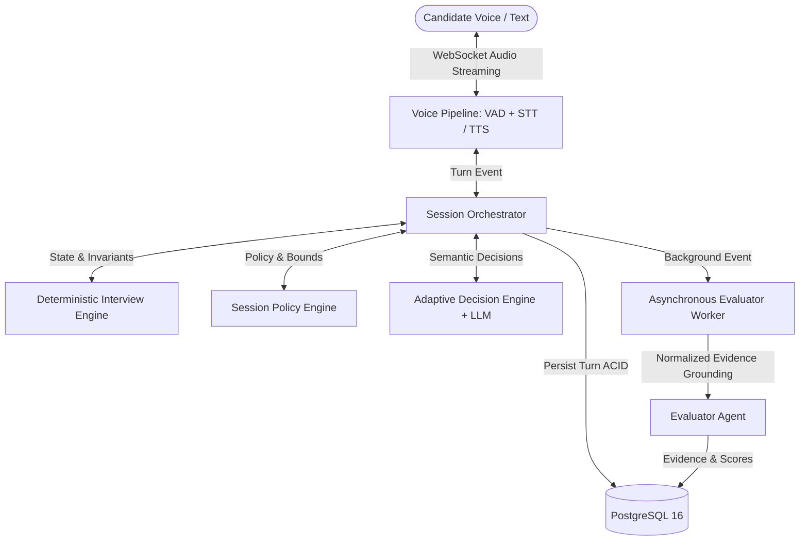
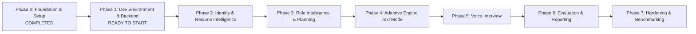

# IntervueX

> **Voice-First, Adaptive AI Technical Interviewing Platform**

IntervueX is an intelligent, voice-first technical interviewing system designed to conduct authentic, adaptive, and deeply technical interviews. Unlike static chatbots that recite canned lists of questions, IntervueX operates as an autonomous, context-aware technical interviewer: it analyzes candidate resumes, understands role competencies, formulates dynamic interview plans, adapts question difficulty in real time based on candidate answers, probes vague claims, challenges technical trade-offs, and generates transparent, evidence-backed evaluation reports.

---

## 🎯 Core Architectural Philosophy

> **"The LLM conducts the conversation, but the Interview Engine controls the interview."**

In IntervueX, the Large Language Model (LLM) is **never** granted unconstrained authority over session state, rubric scoring, competency progression, or time allocation. Instead, IntervueX employs a **three-tier architecture**:

- **Deterministic Invariants**: Enforces hard session stops, turn persistence before state advancement, closed 9-action space, and non-penalizing treatment of unassessed competencies.
- **Configurable Session Policy**: Governs required competencies, weighted coverage targets, maximum probe limits, topic time budgets, and conclusion buffers.
- **Probabilistic LLM Intelligence**: Interprets nuanced technical speech, evaluates semantic depth, assesses reasoning, detects ambiguities, and drafts targeted follow-ups.



---

## 👥 Engineering Constitution & Learning-First Development

IntervueX is engineered with a strict **learning-first philosophy**. This repository serves as both a production-grade software system and an interactive engineering classroom.

### The 15-Point Learning Requirement
For **every** code change, the following 15 points are systematically taught:
1. What problem are we solving?
2. Why does this problem exist?
3. What concept or engineering principle is involved?
4. How does the existing system work?
5. What exactly are we going to change?
6. Why is this approach appropriate?
7. What alternatives exist?
8. What are the trade-offs?
9. How does the implementation work, step by step?
10. What does each important function, class, or configuration do?
11. How does this change interact with other parts of the system?
12. What could go wrong?
13. How do we test it?
14. How can I debug it independently?
15. What should I understand before moving to the next task?

---

## 🏗️ Technology Stack

| Layer | Technology | Primary Rationale |
| :--- | :--- | :--- |
| **Backend API** | Python 3.12+, FastAPI, Pydantic v2 | High-performance asynchronous I/O, native WebSocket support, strict type validation. |
| **Persistence** | PostgreSQL 16, SQLAlchemy 2.0 (Async), Alembic | ACID transactions, relational integrity for evaluation evidence, robust indexing. |
| **Transient State** | Redis 7 | Sub-millisecond session caching, streaming coordination, ephemeral ticket storage. |
| **Worker Queue** | Taskiq (Redis-backed async worker with Transactional Outbox) | Actively maintained, native `asyncio`, type-safe dependency injection via `taskiq-fastapi`, zero Celery bloat. |
| **Frontend** | React 18, TypeScript 5, Vite, Tailwind CSS | Type-safe UI components, responsive layout, predictable state management. |
| **Client State** | TanStack Query v5, Zustand | Server-state caching and lightweight, predictable local UI state management. |
| **Voice & AI** | Deepgram / Whisper (STT), Cartesia / ElevenLabs (TTS), Gemini / Anthropic / OpenAI (LLM) | Modular provider abstraction interfaces with structured Pydantic schemas. |

---

## 📁 Repository Structure

```text
IntervueX/
├── .agents/                        # Antigravity AI engineering configuration
│   ├── rules/*.md                  # Enforceable rules (01-18)
│   └── skills/<skill>/SKILL.md     # 10 Multi-step operational skills
├── AGENTS.md                       # Root Antigravity agent instructions
├── README.md                       # Project overview
├── docs/                           # Authoritative engineering documentation
│   ├── product/                    # PRD, personas, journeys, catalog, scope, roadmap
│   ├── architecture/               # System design, data flow, voice, engine, ADRs
│   ├── database/                   # ERD, schemas, migration strategy
│   ├── api/                        # REST and WebSocket specifications
│   ├── engineering/                # Coding standards, tests, debugging, setup, review
│   └── learning/                   # Learning path, glossary, engineering journal
├── backend/                        # Python FastAPI backend (Phase 1+)
├── frontend/                       # React TypeScript frontend (Phase 1+)
└── docker-compose.yml              # Local infrastructure orchestration
```

---

## 📚 Authoritative Documentation Guide

| Category | Primary Documents |
| :--- | :--- |
| **Product** | [Product Requirements Document (PRD)](docs/product/PRD.md) • [User Personas](docs/product/USER_PERSONAS.md) • [User Journeys](docs/product/USER_JOURNEYS.md) • [Feature Catalog](docs/product/FEATURE_CATALOG.md) • [MVP Scope](docs/product/MVP_SCOPE.md) • [Acceptance Criteria](docs/product/ACCEPTANCE_CRITERIA.md) • [Non-Goals](docs/product/NON_GOALS.md) • [Canonical Roadmap](docs/product/ROADMAP.md) |
| **Architecture** | [System Overview](docs/architecture/SYSTEM_OVERVIEW.md) • [Component Architecture](docs/architecture/COMPONENT_ARCHITECTURE.md) • [Data Flow](docs/architecture/DATA_FLOW.md) • [Adaptive Interview Engine](docs/architecture/ADAPTIVE_INTERVIEW_ENGINE.md) • [Voice Pipeline](docs/architecture/VOICE_PIPELINE.md) • [Security Architecture](docs/architecture/SECURITY_ARCHITECTURE.md) • [Failure Handling](docs/architecture/FAILURE_HANDLING.md) • [Scalability](docs/architecture/SCALABILITY.md) • [Architecture Decisions (ADRs)](docs/architecture/ARCHITECTURE_DECISIONS.md) |
| **Database** | [Entity Relationship Diagram (ERD)](docs/database/ERD.md) • [Data Model Specification](docs/database/DATA_MODEL.md) • [Migration Strategy](docs/database/MIGRATION_STRATEGY.md) |
| **API** | [API Standards](docs/api/API_STANDARDS.md) • [API Specification](docs/api/API_SPECIFICATION.md) • [WebSocket Protocol](docs/api/WEBSOCKET_PROTOCOL.md) • [Error Handling](docs/api/ERROR_HANDLING.md) |
| **Engineering** | [Coding Standards](docs/engineering/CODING_STANDARDS.md) • [Testing Strategy](docs/engineering/TESTING_STRATEGY.md) • [Debugging Guide](docs/engineering/DEBUGGING_GUIDE.md) • [Local Development](docs/engineering/LOCAL_DEVELOPMENT.md) • [Environment Configuration](docs/engineering/ENVIRONMENT_CONFIGURATION.md) • [Dependency Policy](docs/engineering/DEPENDENCY_POLICY.md) • [Definition of Done](docs/engineering/DEFINITION_OF_DONE.md) • [Foundation Review](docs/engineering/FOUNDATION_REVIEW.md) • [Third-Pass Review](docs/engineering/THIRD_PASS_REVIEW.md) |
| **Learning** | [Learning Path](docs/learning/LEARNING_PATH.md) • [Concept Glossary](docs/learning/CONCEPT_GLOSSARY.md) • [Engineering Journal](docs/learning/ENGINEERING_JOURNAL.md) • [Debugging Lessons](docs/learning/DEBUGGING_LESSONS.md) |

---

## 🗺️ Canonical Phased Roadmap



- **Phase 0 (Completed)**: Product & engineering foundation, Antigravity rules system, engineering constitution, and second-pass review.
- **Phase 1 (Next)**: Docker Compose backing services (PostgreSQL, Redis, MinIO), FastAPI skeleton via `uv`, async SQLAlchemy 2.0, Alembic, and health check endpoints.
- **Phase 2**: Candidate registration, JWT authentication, PDF resume parsing with PyMuPDF, and structured claim extraction with character offset provenance.
- **Phase 3**: Role competency catalog (Backend, Frontend, Fullstack), 4-tier rubrics, and deterministic `InterviewBlueprint` builder.
- **Phase 4**: Adaptive Interview Engine, turn state machine, 9-action space, bounded context sliding window, and text-based interviews.
- **Phase 5**: Real-time WebSocket audio streaming (16kHz 16-bit PCM), Web Audio capture worklet, server-side Silero VAD, streaming STT/TTS, and 150ms barge-in preemption.
- **Phase 6**: Decoupled Taskiq evaluation worker, transactional outbox dispatcher, normalized evidence grounder, resume claim verification ledger, and interactive assessment dossier.
- **Phase 7**: Redis rate limiting, OpenTelemetry distributed tracing, circuit breakers, and 100-scenario synthetic replay benchmark harness.

---

## 🔒 Ethics & Responsible AI Guarantees

IntervueX strictly enforces the following ethical constraints:
1. **Zero Biometric Proxying**: We never analyze candidate video, facial expressions, micro-movements, eye gaze, vocal pitch, tone, or accents as proxies for technical competence.
2. **No Automated Hiring Decisions**: IntervueX produces evidence-backed assessment reports; human hiring managers remain the sole decision-makers.
3. **Transparent Evidence**: Every score, feedback bullet, and claim verification links directly to transcript turns, timestamped quotes, and character offsets.
4. **Candidate Consent**: Explicit opt-in microphone and transcript storage consent is required prior to starting any session.

---

## 📄 License
This project is licensed under the terms described in [LICENSE.txt](LICENSE.txt).
