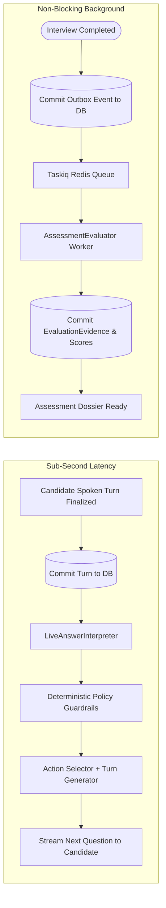

# Adaptive Interview Engine Specification — IntervueX

**Document Version:** 1.2.0  
**Status:** Approved Technical Specification  

---

## 1. Architectural Philosophy: The Three-Tier Control Model

The **Adaptive Interview Engine (AIE)** simulates the judgment of an experienced engineering interviewer who listens actively, probes depth, and verifies claims, while operating within rigorous session boundaries.

Rather than granting an LLM unconstrained conversational freedom, IntervueX structures interview control into three distinct tiers:

```mermaid
graph TD
    subgraph Tier 1: Deterministic Constraints [Hard System Invariants]
        H1[Hard Session Termination at max_duration]
        H2[Atomic Turn Persistence before Action Execution]
        H3[Closed 9-Action Space Enforcement]
        H4[Incomplete Coverage Non-Penalization: INSUFFICIENT_EVIDENCE]
    end

    subgraph Tier 2: Configurable Session Policy [InterviewPolicy]
        P1[Required Competencies List: required_competency_ids]
        P2[Weighted Competency Coverage Target: minimum_coverage_ratio]
        P3[Max Consecutive Probes per Topic: max_consecutive_probes]
        P4[Topic Time Budgets & Conclusion Buffer]
        P5[Minimum Evidence Items per Competency: min_evidence_items]
    end

    subgraph Tier 3: Probabilistic LLM Recommendations [AI Semantic Core]
        L1[LiveAnswerInterpreter: Real-Time Answer Depth & Ambiguity]
        L2[Recommend Next Action from 9 Actions]
        L3[Draft Spoken Question Aligned to Action]
    end

    Tier 1 --> Tier 2
    Tier 2 --> Tier 3
```

1. **Deterministic Constraints (Hard Invariants)**: System-level non-negotiables that cannot be bypassed by any prompt or configuration.
2. **Configurable Session Policy (`InterviewPolicy`)**: Parameters specified per job role, template, or seniority level.
3. **Probabilistic LLM Recommendations**: Semantic reasoning on candidate statements to propose actions and generate natural spoken phrasing.

---

## 2. Evaluation Boundaries: `LiveAnswerInterpreter` vs. `AssessmentEvaluator`

A critical architectural invariant in IntervueX is the **strict separation between live adaptation and post-interview rubric evaluation**. Live turn-taking must never wait for comprehensive rubric evaluation, and live adaptation must never be blocked by background report generation.



### Detailed Component Comparison

| Dimension | `LiveAnswerInterpreter` | `AssessmentEvaluator` |
| :--- | :--- | :--- |
| **Execution Environment** | Synchronous coroutine in FastAPI live session orchestrator | Asynchronous background worker (`Taskiq`) |
| **Primary Responsibility** | Rapid semantic interpretation of immediate candidate response depth, ambiguities, and conversational flow | Exhaustive, multi-turn rubric scoring, verbatim evidence extraction, and claim audit |
| **Latency Budget (Hypothesis)** | **$\le 600$ ms** (TTFT $\le 400$ ms) — *Design hypothesis to be benchmarked* | **30 – 90 seconds** total execution window |
| **Measurement Boundary** | **Starts**: Instant final turn transcript is committed to PostgreSQL.<br/>**Ends**: Instant structured `InterpretationResult` is emitted. | **Starts**: Outbox event claimed by worker.<br/>**Ends**: `assessment_reports` and normalized evidence committed. |
| **Inputs** | - Current turn transcript<br/>- Active blueprint competency goal<br/>- Rolling summary of last 4 turns<br/>- Relevant candidate resume claims | - Complete immutable transcript of all turns<br/>- Role competencies & versioned 4-tier rubrics<br/>- All candidate resume claims<br/>- Active `InterviewPolicy` |
| **Outputs** | `InterpretationResult`: observed depth (`SHALLOW`, `ADEQUATE`, `DEEP`, `EVASIVE`, `STUCK`), contradiction flag, recommended action, key entities mentioned | `AssessmentReport`, `CompetencyScore` records, and normalized `EvaluationEvidence` rows with character offsets |
| **Persistence Requirements**| Ephemeral in memory during turn cycle; logged in `interview_turns.action_taken` and metadata for observability | Durable ACID write transaction in PostgreSQL |
| **Failure Behavior** | **Deterministic Fallback**: on timeout ($>600$ ms) or error, engine bypasses LLM and queries seeded role competency question banks to select a pre-compiled question matching active competency. Zero conversational dead air. | **Reliable Retry**: automatic exponential backoff retries via Taskiq; failure moves to Dead Letter Queue |

### 2.1 Staged Turn-Taking Latency Budget (Hypotheses)
The conversational loop is partitioned into distinct stages to isolate latency bottlenecks. All values represent **engineering design hypotheses** to be benchmarked during implementation:

1. **Stage 1: Trailing Silence Detection (Silero VAD)**: $800 - 1,200$ ms (configurable candidate pause window).
2. **Stage 2: Final STT Transcription**: $150 - 250$ ms (Deepgram / Whisper streaming finalization).
3. **Stage 3: Turn ACID Persistence**: $15 - 30$ ms (PostgreSQL commit before downstream action).
4. **Stage 4: Live Semantic Interpretation (`LiveAnswerInterpreter`)**: $\le 600$ ms (TTFT $\le 400$ ms) — **[The 600 ms Measurement Boundary]**.
5. **Stage 5: Deterministic Policy & Guardrail Verification**: $\le 10$ ms (in-memory probe count and time checks).
6. **Stage 6: Spoken Question Phrasing / Turn Generation**: $400 - 600$ ms TTFT.
7. **Stage 7: TTS Audio Chunk Synthesis (TTFB)**: $150 - 250$ ms (Cartesia / ElevenLabs streaming).

**Target End-to-End Voice Turn Latency**: $\le 1,800$ ms (p90 hypothesis, measured from candidate silence confirmation to first audio byte delivered to client speakers).

### 2.2 Deterministic Fallback on LLM Unavailability or Latency Spikes
If the LLM provider fails (returns HTTP 429, 503, or exceeds the 600 ms interpreter timeout or 1,000 ms generator timeout):
1. The engine **aborts the LLM call immediately** without stalling the session.
2. The **Deterministic Fallback Generator** queries the local seeded competency database for the current topic.
3. It selects a pre-compiled, vetted technical question or clarification prompt directly mapped to the required action:
   - *Example (`PROBE_DEEPER` on Databases)*: *"Could you dive deeper into the indexing strategy or isolation level you chose for that workflow?"*
   - *Example (`CHALLENGE` on Distributed Systems)*: *"What trade-offs did you make between consistency and availability during network partitions in that setup?"*
4. The question is streamed to TTS immediately, ensuring the candidate experiences zero dead air or perception of system failure.

---

## 3. Closed Action Space

Every interviewer turn is driven by one of **nine mutually exclusive actions**:

| Action Enum | Purpose & Intent | Typical Trigger Conditions | Example Spoken Direction |
| :--- | :--- | :--- | :--- |
| `PROBE_DEEPER` | Investigate the underlying mechanism, internal implementation, or data structures. | Candidate gave a high-level conceptual answer that lacked concrete technical mechanics. | *"You mentioned using Redis for rate limiting—how did you implement the sliding window algorithm at the Redis key level?"* |
| `CLARIFY` | Request resolution of ambiguous, vague, or self-contradictory statements. | Candidate used conflicting terminology or skipped essential steps in their explanation. | *"Earlier you mentioned eventual consistency, but then said reads are immediately consistent across replicas. Could you clarify that topology?"* |
| `CHALLENGE` | Test candidate understanding of edge cases, failure modes, scale limits, or trade-offs. | Candidate proposed an ideal architecture that breaks under network partitions or high load. | *"What happens if the primary database node crashes midway through that distributed saga? How is state reconciled?"* |
| `VERIFY_CLAIM` | Pivot the inquiry to a specific technical claim from the candidate's resume. | A high-priority unverified resume claim matches the current competency discussion. | *"Your resume mentions scaling an Elasticsearch cluster to 10 TB. What indexing strategies or shard routing did you use to prevent search latency degradation?"* |
| `SCENARIO` | Present a realistic production incident, design prompt, or system outage. | Candidate demonstrated theoretical knowledge; now test real-world debugging intuition. | *"Imagine users report intermittent 504 Gateway Timeouts during deployment. How would you systematically isolate whether it's DNS, ingress, or upstream services?"* |
| `CHANGE_TOPIC` | Transition to a new target competency from the interview blueprint. | Current competency has reached saturation (evidence gathered or topic budget expired). | *"Let's shift gears from database storage engines to API architecture and caching strategies."* |
| `SIMPLIFY` | Provide scaffolding, a concrete hint, or break down the problem if candidate is stuck. | Candidate fell silent, expressed confusion, or gave an answer demonstrating significant struggle. | *"Let's simplify: instead of distributed consensus across 5 nodes, how would you solve leader election with a simple shared Redis lock?"* |
| `REVISIT` | Circle back to an earlier unanswered or partially addressed technical question. | Candidate previously deferred an answer (*"I'll come back to that"*). | *"Earlier we touched on database deadlocks—let's return to how you detected and mitigated those lock contentions."* |
| `CONCLUDE` | Finalize technical questioning, invite candidate questions, and wrap up. | Configurable coverage threshold met and session enters conclusion buffer window. | *"We've covered our core topics today. Before we wrap up, do you have any questions for me about the team or systems?"* |

---

## 4. Configurable Policy Model (`InterviewPolicy`)

The interview policy is loaded from the interview template or customized upon session creation:

```python
class InterviewPolicy(BaseModel):
    max_duration_seconds: int = Field(default=1800, ge=600, le=5400)
    conclusion_buffer_seconds: int = Field(default=180, ge=60, le=600)
    warmup_duration_seconds: int = Field(default=240, ge=60, le=600)
    max_consecutive_probes: int = Field(default=3, ge=1, le=6)
    minimum_coverage_ratio: float = Field(default=0.70, ge=0.50, le=1.0)
    min_evidence_items_per_competency: int = Field(default=2, ge=1, le=5)
    required_competency_ids: list[uuid.UUID] = Field(default_factory=list)
    competency_weights: dict[uuid.UUID, float] = Field(default_factory=dict)
```

### Policy Execution Invariants:
1. **Probe Saturation**: If `consecutive_probes >= policy.max_consecutive_probes`, the engine forcibly overrides any LLM `PROBE_DEEPER` suggestion to `CHANGE_TOPIC` or `SCENARIO`.
2. **Topic Time Budgets**: If a topic's allocated seconds expire, the engine advances to the next unprobed competency.
3. **Required Competencies Priority**: If `elapsed_time` approaches `max_duration_seconds - conclusion_buffer_seconds` and a required competency has 0 evidence items, the engine forcibly selects `CHANGE_TOPIC` to that required competency.
4. **Handling Incomplete Coverage**: If hard session duration is reached before all scheduled competencies are probed:
   - The engine triggers deterministic termination.
   - Unassessed competencies are recorded as `status = 'INSUFFICIENT_EVIDENCE'`.
   - Their score is set to `NULL` (never 0 or 1), ensuring the candidate is not penalized for time constraints.
   - Overall composite score is calculated using re-normalized weights over the evaluated subset.

---

## 5. Bounded Prompt Context Construction

To ensure low latency ($\le 600$ ms for `LiveAnswerInterpreter`) and eliminate token inflation, prompts are bounded via a **Sliding Window + Rolling Summary**:
- **System Instructions**: Role, seniority, active competency, rubric criteria, and Pydantic output schema (~500 tokens).
- **Rolling Summary**: Compact bullet points of evidence established in earlier turns (~300 tokens).
- **Active Claim Context**: Provenance and text of relevant resume claims (~200 tokens).
- **Sliding Window**: Last 4 full dialogue turns (Interviewer $\rightarrow$ Candidate $\rightarrow$ Interviewer $\rightarrow$ Candidate) (~600 tokens).
- **Total Token Target**: 1,200 – 1,800 tokens.
