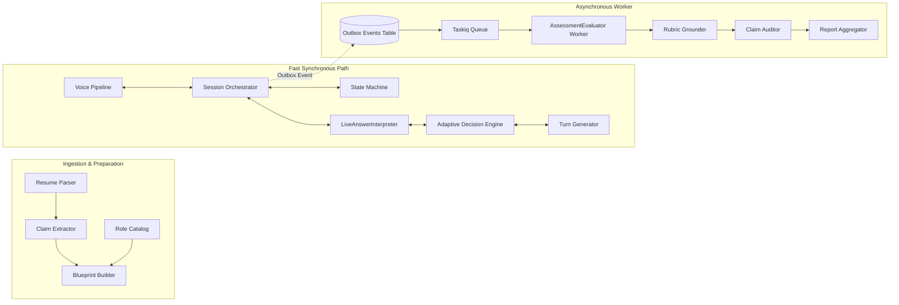

# Component Architecture — IntervueX

**Document Version:** 1.2.0  
**Status:** Approved Component Blueprint  

---

## 1. Component Topology



---

## 2. Ingestion & Preparation Components

### 2.1 Resume Parser (`intervuex.modules.resume.parser`)
- **Responsibility**: Ingest raw PDF/DOCX bytes, extract textual blocks, clean control characters, normalize text to Unicode NFC, and identify structural sections (Summary, Experience, Education, Projects).
- **Core Interface**:
  ```python
  class ResumeParserProtocol(Protocol):
      async def parse(self, file_bytes: bytes, filename: str) -> ParsedDocument:
          ...
  ```
- **Failure Boundaries**: Password-protected PDF, corrupted streams, unreadable OCR scans. Raises `ResumeParsingError`.

### 2.2 Claim Extractor (`intervuex.modules.resume.extractor`)
- **Responsibility**: Analyze parsed text blocks using structured LLM schemas to extract atomic, testable claims with exact character provenance (`start_offset`, `end_offset` in Unicode codepoints).
- **Data Model**:
  ```python
  class ExtractedClaim(BaseModel):
      claim_text: str
      category: ClaimCategory  # EXPLICIT_FACT | INFERRED_SKILL | VAGUE_CLAIM
      source_section: str
      start_offset: int  # Unicode codepoints
      end_offset: int    # Unicode codepoints
      technologies: list[str]
      testable_prompt: str
  ```

### 2.3 Blueprint Builder (`intervuex.modules.blueprint.builder`)
- **Responsibility**: Generate an `InterviewBlueprint` matching role competencies to candidate claims while partitioning total session time into discrete topic budgets according to the active `InterviewPolicy`.
- **Invariants**: Sum of topic time budgets must equal total scheduled duration. At least 3 competencies must be scheduled for a 30+ minute session.

---

## 3. Live Interview Loop Components

### 3.1 Session Orchestrator (`intervuex.modules.session.orchestrator`)
- **Responsibility**: Central coordinator for a live interview. Connects the WebSocket stream, VAD events, state machine, decision engine, database persistence, and TTS streaming.
- **State Guarantee**: Every candidate turn must be committed to PostgreSQL via `TurnRepository.persist_turn()` before requesting interpretation or next-action generation.

### 3.2 LiveAnswerInterpreter (`intervuex.modules.engine.interpreter`)
- **Responsibility**: Fast, synchronous semantic interpretation of the candidate's latest response.
- **Latency Budget**: $\le 600$ ms TTFT.
- **Data Model**:
  ```python
  class InterpretationResult(BaseModel):
      depth: AnswerDepth  # SHALLOW | ADEQUATE | DEEP | EVASIVE | STUCK
      has_contradiction: bool
      contradiction_notes: str | None = None
      recommended_action: EngineAction
      key_entities_mentioned: list[str]
      rationale: str
  ```
- **Failure Behavior**: On timeout ($>600$ ms) or provider error, falls back immediately to deterministic rule-based action selection without stalling the conversation.

### 3.3 Deterministic State Machine (`intervuex.modules.engine.state_machine`)
- **Responsibility**: Governs macro-level interview phases and enforces hard limits.
- **State Transitions**: `CREATED` $\rightarrow$ `INITIALIZING` $\rightarrow$ `WARMUP` $\rightarrow$ `TECHNICAL_CORE` $\rightarrow$ `CONCLUDING` $\rightarrow$ `COMPLETED`.

### 3.4 Adaptive Decision Engine (`intervuex.modules.engine.decision_engine`)
- **Responsibility**: Evaluates candidate statements against active `InterviewPolicy` and selects the next action from the closed 9-action space:
  `PROBE_DEEPER`, `CLARIFY`, `CHALLENGE`, `VERIFY_CLAIM`, `SCENARIO`, `CHANGE_TOPIC`, `SIMPLIFY`, `REVISIT`, `CONCLUDE`.
- **Policy Enforcement**: Overrides LLM recommendation if consecutive probes exceed limit or topic budget expires.

---

## 4. Voice Pipeline Components

### 4.1 Voice Pipeline Coordinator (`intervuex.modules.voice.coordinator`)
- **Responsibility**: Manage real-time bidirectional audio streaming between the browser WebSocket and speech providers.
- **Sub-components**:
  - `AudioWorklet`: Client-side capture and downsampling from hardware rate (44.1/48kHz) to 16kHz Linear PCM.
  - `SileroVADDetector`: Identifies speech start and end thresholds locally on incoming 50ms audio frames.
  - `StreamingSTTClient`: Bridges 16kHz PCM audio to Deepgram/Whisper streaming endpoints.
  - `StreamingTTSClient`: Streams synthesized 16kHz PCM audio back to client chunks.
  - `BargeInController`: Watches for candidate voice energy during TTS output and triggers immediate cancellation.

---

## 5. Decoupled Asynchronous Evaluation Components

### 5.1 Outbox Poller Service (`intervuex.modules.outbox.poller`)
- **Responsibility**: Independent, dedicated event-driven publisher loop polling `outbox_events` in PostgreSQL using short-lived row leases.
- **Architectural Separation**: The `OutboxPoller` is **completely distinct from Taskiq's scheduler (`TaskiqScheduler`)**. TaskiqScheduler handles cron/periodic jobs; OutboxPoller handles transactionally reliable event dispatch to the Taskiq broker.
- **Lease Mechanics**: Claims up to 50 rows via `FOR UPDATE SKIP LOCKED`, sets `status = 'CLAIMED'` with a 30-second TTL, and **commits the database transaction immediately**. It dispatches events over network I/O without holding database row locks open.
- **Publication ACK**: A row transitions to `PUBLISHED` only after the broker returns an explicit protocol ACK.

### 5.2 Broker Abstraction Layer
- **Broker Decision**: Taskiq worker execution is strictly decoupled from the choice of message broker.
  - **MVP Primary**: Redis broker (`taskiq-redis`) for low latency and lightweight deployment.
  - **Evaluated Alternative**: PostgreSQL broker (`taskiq-pg`) for zero-infrastructure deployment if operational policy mandates eliminating Redis.

### 5.3 AssessmentEvaluator Worker (`intervuex.modules.evaluation.evaluator`)
- **Responsibility**: Asynchronous worker task (Taskiq) evaluating the full interview transcript against versioned 4-tier rubrics, generating normalized evidence records.
- **Execution Context**:
  - **No FastAPI Request Context**: Workers run in isolated worker processes. They **never assume HTTP request state, headers, client IP, or request-scoped dependencies are available**.
  - **Explicit Task Inputs**: Tasks accept strictly serializable primitive arguments:
    ```python
    @broker.task
    async def evaluate_interview_task(
        session_id: str,
        idempotency_key: str,
        correlation_id: str,
    ) -> str:
        ...
    ```
  - **Worker-Managed Resource Lifecycle**: The worker opens its own `AsyncSession` from the database session factory, initializes required LLM provider clients, executes evaluation, and ensures deterministic resource cleanup in `finally` blocks.
- **Latency Budget (Hypothesis)**: 30 – 90 seconds total. Runs entirely decoupled from live conversation turns.
- **Data Model**:
  ```python
  class EvaluationEvidenceItem(BaseModel):
      turn_id: uuid.UUID
      evidence_type: EvidenceType  # POSITIVE_MASTERY | KNOWLEDGE_GAP | CONTRADICTION | SUPERFICIAL_EXPLANATION
      assessment_impact: AssessmentImpact  # UPWEIGHT | DOWNWEIGHT | NEUTRAL | DISQUALIFYING
      transcript_excerpt: str
      start_char_offset: int  # Unicode codepoints
      end_char_offset: int    # Unicode codepoints
      confidence: float = Field(ge=0.0, le=1.0)
      rationale: str

  class RubricEvaluation(BaseModel):
      competency_id: uuid.UUID
      score: int | None = Field(None, ge=1, le=4)
      status: EvaluationStatus  # EVALUATED | INSUFFICIENT_EVIDENCE
      evidence_items: list[EvaluationEvidenceItem]
      rationale: str
      confidence: float = Field(ge=0.0, le=1.0)
  ```

### 5.4 Claim Auditor (`intervuex.modules.evaluation.claim_auditor`)
- **Responsibility**: Cross-reference candidate statements against extracted resume claims to produce session-scoped `interview_claim_verifications`.

### 5.5 Report Aggregator (`intervuex.modules.reporting.aggregator`)
- **Responsibility**: Consolidate competency scores, normalized evidence rows, claim verifications, and knowledge gaps into a complete, immutable `AssessmentReport` with incrementing version, protected against concurrent worker races via session row-level locks.
