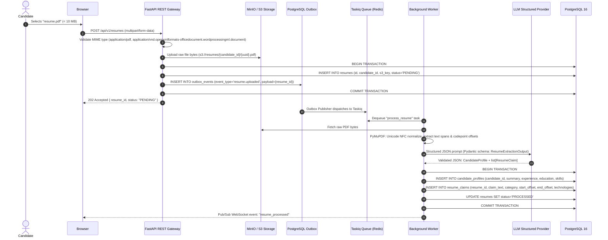
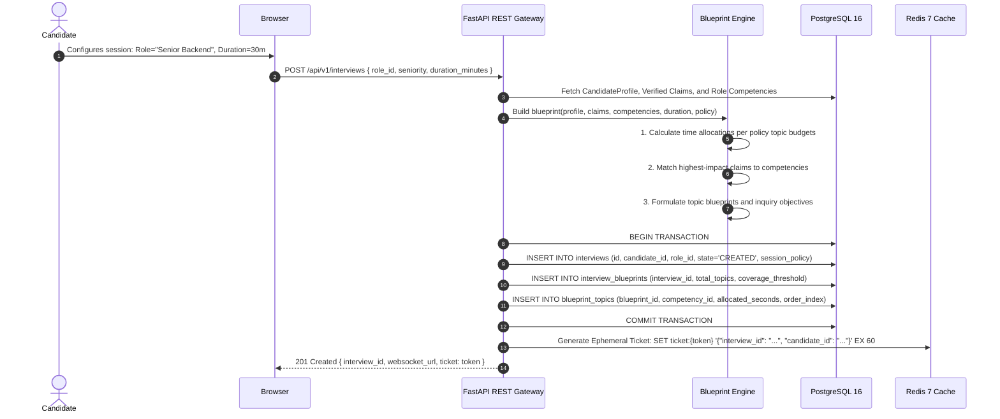
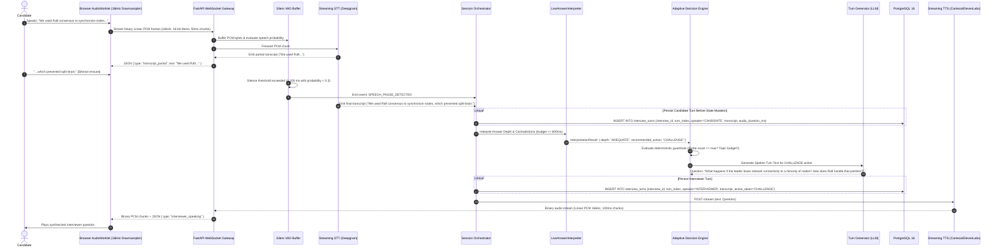
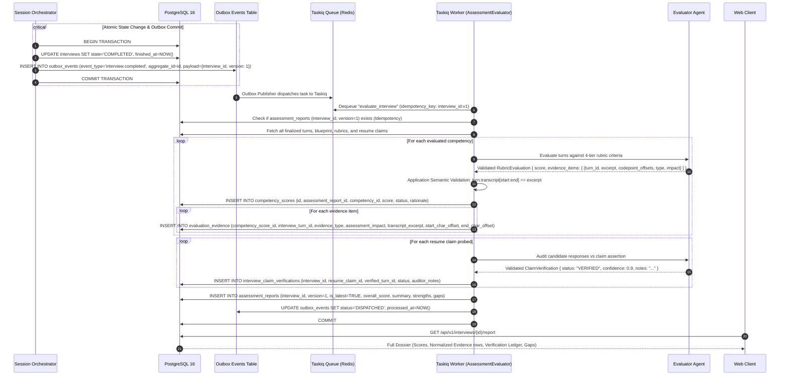

# End-to-End Data Flow — IntervueX

**Document Version:** 1.2.0  
**Status:** Approved Technical Architecture  

---

## 1. Pipeline 1: Resume Ingestion & Claim Extraction

---

## 2. Pipeline 2: Blueprint & Session Initialization

---

## 3. Pipeline 3: Real-Time Adaptive Voice Turn Loop

---

## 4. Pipeline 4: Decoupled Outbox Evaluation & Dossier Generation

