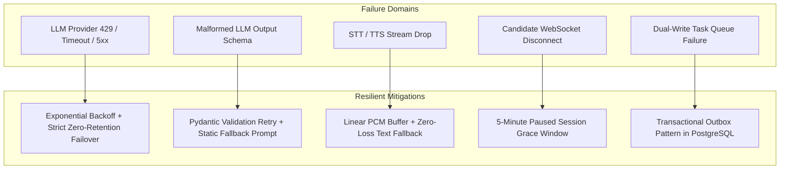

# Failure Handling & Fault Tolerance — CareerDiff

**Document Version:** 1.2.0  
**Status:** Approved Technical Architecture  

---

## 1. Reliability Philosophy: Graceful Degradation & Bounded RTO/RPO

In a voice-first real-time platform, failure will inevitably occur: external AI APIs timeout, candidate Wi-Fi drops, LLMs generate invalid JSON, and audio streams encounter jitter.

The core reliability philosophy of CareerDiff is:
> **"Never crash the interview. Degrade gracefully, preserve session state, and fall back to deterministic safety."**



---

## 2. Failure Recovery Matrices

### 2.1 LLM Provider Outages & Latency Spikes

#### Latency Measurement Boundary & Staged Hypotheses
The **600 ms measurement boundary** for `LiveAnswerInterpreter` is strictly defined as:
- **T_start**: The exact millisecond the candidate's final speech turn transcript is confirmed by STT and durably committed to PostgreSQL.
- **T_end**: The exact millisecond `LiveAnswerInterpreter` emits the structured `InterpretationResult` Pydantic model to the Session Orchestrator.

All latency numbers are **engineering design hypotheses** to be empirically benchmarked in Phase 4 (text) and Phase 5 (voice):

```text
Staged Turn-Taking Latency Budget (Hypotheses):
  Stage 1: Candidate Trailing Silence Detection (Silero VAD):      800 – 1,200 ms (configurable)
  Stage 2: Final STT Stream Finalization (Deepgram Nova-2):         150 – 250 ms
  Stage 3: PostgreSQL Turn ACID Persistence:                         15 – 30 ms
  Stage 4: LiveAnswerInterpreter (Semantic Interpretation):         <= 600 ms (TTFT <= 400 ms)  <-- [600ms Boundary]
  Stage 5: Deterministic Policy & Guardrails Check:                 <= 10 ms
  Stage 6: Question Phrasing & Turn Generation (LLM Stream):        400 – 600 ms TTFT
  Stage 7: TTS First Audio Chunk (Cartesia / ElevenLabs):           150 – 250 ms
  ---------------------------------------------------------------------------------------------
  Target End-to-End Voice Turn Latency (p90 Hypothesis):          <= 1,800 ms (after silence finalized)
```

#### Handling Strategy & Deterministic Fallback:
1. **Timeout Enforcement**: All live interpretation calls (`LiveAnswerInterpreter`) enforce an explicit timeout budget: `asyncio.wait_for(timeout=0.6)`. Question phrasing enforces `asyncio.wait_for(timeout=1.0)`.
2. **Deterministic Emergency Fallback**:
   - If the LLM provider fails (HTTP 429, 503, or timeout $>600$ ms), the engine **does not stall or generate dead air**.
   - It activates the **Deterministic Fallback Generator**: retrieves a pre-compiled, rubric-aligned question from the seeded `role_competencies` catalog for the current active competency and action.
   - *Example*: For `PROBE_DEEPER` on Concurrency: *"Could you elaborate on how you handled deadlocks or race conditions in that system?"*
   - Guarantees seamless conversational continuity even under total external LLM outage.
3. **Privacy-Constrained Secondary Fallback**:
   - If a multi-provider setup is active, failover is **only permitted to secondary providers possessing a verified Enterprise DPA (zero data retention, zero training)**. If no compliant provider is reachable, the engine uses the deterministic fallback.

### 2.2 Malformed LLM Structured Outputs
- **Failure Mode**: The LLM outputs invalid JSON or hallucinates an action enum that does not exist in `EngineAction`.
- **Handling Strategy**:
  1. Pydantic v2 validation parses the raw string.
  2. If `ValidationError` is raised, the error message and expected schema are fed into a 1-turn correction prompt.
  3. If correction fails, the engine falls back to a deterministic default: `EngineAction.PROBE_DEEPER` if on current topic, or `EngineAction.CHANGE_TOPIC` if topic budget is exceeded.

### 2.3 Streaming Speech (STT / TTS) Failures
- **Failure Mode**: Deepgram or Cartesia WebSocket disconnects abruptly mid-stream.
- **Handling Strategy**:
  1. In-flight 16kHz PCM chunks are retained in a rolling 5-second circular ring buffer in server memory.
  2. STT client automatically initiates a WebSocket reconnect with the buffered audio.
  3. If TTS fails to synthesize within 1,000 ms, the server falls back to returning the plain-text question over WebSocket, prompting the client UI to render the question as text and chime.

### 2.4 Candidate Network Disconnection
- **Failure Mode**: Candidate Wi-Fi disconnects or browser tab crashes.
- **Handling Strategy**:
  1. The server detects WebSocket ping timeout after 10 seconds.
  2. The session transitions to state `PAUSED` in Redis with an expiration of 300 seconds (5 minutes).
  3. The current turn index, accumulated audio, and blueprint state remain frozen.
  4. When the candidate reloads the page, the frontend fetches `GET /api/v1/interviews/{id}/resume-token` and reconnects to the WebSocket.
  5. The server emits `{ "type": "session_resumed", "current_turn": 12 }` and replays the last interviewer question.
  6. If 5 minutes elapse without reconnection, the session transitions to `ABORTED` and triggers an audit event.

---

## 3. Background Job Reliability: Transactional Outbox, Short-Lived Leases & Durable Idempotency

### 3.1 At-Least-Once Delivery (Not Exactly-Once Execution)
The Transactional Outbox pattern strictly guarantees **At-Least-Once Delivery** to the message broker. In distributed systems with network partitions, broker retries, and worker crashes, exactly-once delivery is impossible. Therefore, the system is designed so that duplicate dispatches are anticipated, benign, and neutralized via **durable consumer idempotency in PostgreSQL**.

### 3.2 Atomic Outbox Insertion & Short-Lived Row Leases
1. **Atomic Insertion**:
   When an interview concludes (`status = 'COMPLETED'`), the state transition and an `outbox_events` record are committed within the **exact same ACID database transaction**:
   ```python
   async with db_session.begin():
       interview.state = InterviewState.COMPLETED
       interview.finished_at = func.now()
       outbox_event = OutboxEvent(
           event_type="interview.completed",
           aggregate_type="interview",
           aggregate_id=interview.id,
           payload={"session_id": str(interview.id), "version": 1},
           status="PENDING",
       )
       db_session.add(outbox_event)
   ```

2. **Short-Lived Row Leases (No Open Transactions During Broker I/O)**:
   The dedicated `OutboxPoller` claims pending rows using a short-lived lease:
   ```sql
   -- Phase 1: Short claim transaction (commits immediately)
   BEGIN;
   SELECT id, payload FROM outbox_events 
   WHERE (status = 'PENDING') OR (status = 'CLAIMED' AND claim_expires_at < NOW())
   ORDER BY created_at FOR UPDATE SKIP LOCKED LIMIT 50;

   UPDATE outbox_events 
   SET status = 'CLAIMED', 
       claimed_by = :poller_instance_id, 
       claimed_at = NOW(), 
       claim_expires_at = NOW() + INTERVAL '30 seconds'
   WHERE id = ANY(:claimed_ids);
   COMMIT;
   ```
   > [!IMPORTANT]
   > **Non-Blocking Rule**: The claim transaction commits immediately. PostgreSQL transactions and row locks are **never held open during broker network calls**.

3. **Definition of Successful Broker Publication**:
   - The poller asynchronously publishes each claimed event to the Taskiq broker.
   - Publication is deemed successful **only when the broker driver explicitly returns a protocol-level acknowledgment** (e.g. Redis `LPUSH`/`XADD` returns the integer queue length, or AMQP confirms `Basic.Ack`).
   - Upon receiving explicit broker acknowledgment, a new short transaction updates the record:
     ```sql
     UPDATE outbox_events 
     SET status = 'PUBLISHED', published_at = NOW() 
     WHERE id = :event_id;
     ```
   - If the broker call times out or throws an exception, the event remains in `CLAIMED`. It will be reclaimed automatically after `claim_expires_at`.

### 3.3 Durable Worker Idempotency via PostgreSQL
Workers **must not rely on Redis alone for idempotency** (Redis is ephemeral and prone to cache eviction or reboot data loss). Idempotency is enforced durably in PostgreSQL via a dedicated `worker_executions` table:

```sql
CREATE TABLE worker_executions (
    id UUID PRIMARY KEY DEFAULT gen_random_uuid(),
    task_name VARCHAR(100) NOT NULL,
    idempotency_key VARCHAR(255) NOT NULL,
    aggregate_id UUID NOT NULL,
    status VARCHAR(30) NOT NULL CHECK (status IN ('RUNNING', 'SUCCESS', 'FAILED')),
    started_at TIMESTAMPTZ NOT NULL DEFAULT NOW(),
    completed_at TIMESTAMPTZ,
    result_reference VARCHAR(255),
    error_message TEXT,
    CONSTRAINT uq_worker_task_idempotency UNIQUE (task_name, idempotency_key)
);
```

**Worker Execution Protocol**:
1. Worker derives `idempotency_key = f"evaluate_interview:{session_id}:v{version}"`.
2. Worker attempts an atomic insert into `worker_executions`:
   ```python
   async with db_session.begin():
       existing = await db_session.execute(
           select(WorkerExecution).where(
               WorkerExecution.task_name == "evaluate_interview",
               WorkerExecution.idempotency_key == idempotency_key
           ).with_for_update()
       )
       record = existing.scalar_one_or_none()
       if record and record.status == "SUCCESS":
           logger.info("Task %s already successfully executed. Skipping.", idempotency_key)
           return record.result_reference
       if not record:
           db_session.add(WorkerExecution(
               task_name="evaluate_interview",
               idempotency_key=idempotency_key,
               aggregate_id=session_id,
               status="RUNNING"
           ))
   ```
3. If an execution record exists with `status = 'SUCCESS'`, the worker exits immediately without re-running LLM evaluation calls.

### 3.4 Safe Report Version Creation Under Concurrent Execution
If two workers execute concurrently for the same session (due to at-least-once delivery or duplicate event pickup):
1. The worker acquires an exclusive row-level lock on the parent interview session:
   ```sql
   SELECT id FROM interview_sessions WHERE id = :session_id FOR UPDATE;
   ```
   *(Alternatively: `SELECT pg_advisory_xact_lock(hashtext('report:' || :session_id::text));`)*
2. It deterministically computes the next sequential version:
   ```sql
   SELECT COALESCE(MAX(version), 0) + 1 FROM assessment_reports WHERE session_id = :session_id;
   ```
3. It sets prior reports to inactive:
   ```sql
   UPDATE assessment_reports SET is_latest = FALSE WHERE session_id = :session_id AND is_latest = TRUE;
   ```
4. It inserts the new report. Database constraints (`UNIQUE (session_id, version)` and partial unique index `UNIQUE (session_id) WHERE is_latest = TRUE`) structurally guarantee report version integrity.

### 3.5 Recovery & Reconciliation for Published but Unfinished Evaluations
If an outbox event transitions to `PUBLISHED` but the worker crashes mid-evaluation (e.g. OOM-kill or power loss):
- A periodic **Reconciliation Sweeper Job** (running every 2 minutes) queries:
  ```sql
  -- Find orphaned completions with no assessment report after 10 minutes
  SELECT s.id FROM interview_sessions s
  LEFT JOIN assessment_reports r ON r.session_id = s.id
  WHERE s.status = 'COMPLETED' 
    AND s.finished_at < NOW() - INTERVAL '10 minutes'
    AND r.id IS NULL;
  ```
- For detected orphaned sessions, the sweeper resets `worker_executions` status if stuck in `RUNNING`, increments an attempt counter, and re-enqueues the evaluation task.
- If attempts exceed 5, the event transitions to `DEAD_LETTER` and fires an alert.

---

## 4. Failure Injection & Chaos Testing Matrix

To guarantee distributed resilience, CareerDiff includes automated failure injection test suites executed against real PostgreSQL and Redis containers:

| Test Identifier | Failure Injected | System Invariant Verified | Expected Outcome |
| :--- | :--- | :--- | :--- |
| **TEST-FAIL-01** | **Duplicate Event Publication** | Worker Idempotency | Worker receives the exact same event payload twice; `worker_executions` catches duplicate; exactly 1 report created. |
| **TEST-FAIL-02** | **Worker SIGKILL Mid-Execution** | Durable State & Recovery | Process killed during LLM evaluation; DB transaction rolls back cleanly; reconciliation sweeper detects missing report and re-dispatches. |
| **TEST-FAIL-03** | **Redis Data Loss / Restart** | PostgreSQL Durability | Redis cache flushed (`FLUSHALL`) while evaluations pending; Outbox poller detects unacknowledged events or reclaims expired leases; zero evaluations lost. |
| **TEST-FAIL-04** | **Concurrent Worker Race** | Safe Report Versioning | Two worker processes execute evaluation for the same `session_id` simultaneously; session row-level lock serializes report insertion; versions 1 and 2 created without unique violation. |
| **TEST-FAIL-05** | **Outbox Poller Crash with Expired Claims** | Lease Expiration Recovery | Poller marks 10 rows `CLAIMED` and terminates immediately; after 30-second TTL expires, new poller instance successfully reclaims and publishes all 10 rows. |
| **TEST-FAIL-06** | **Broker Outage During Outbox Polling** | Non-Blocking DB Transactions | Broker connection intentionally severed; OutboxPoller logs publication failure; PostgreSQL transactions are not held open; rows remain safely in `CLAIMED` until lease expiry. |
