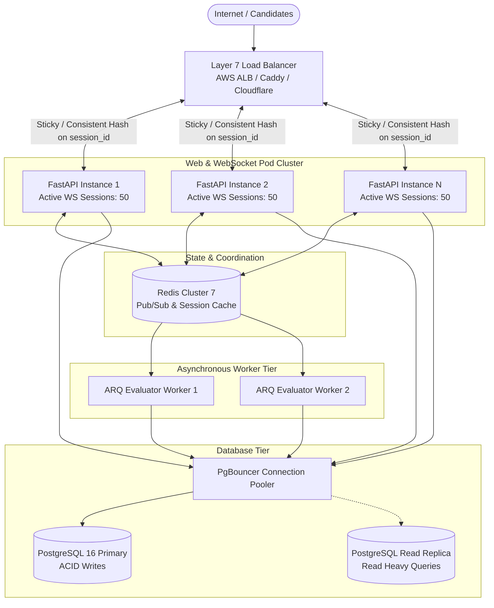

# Scalability & Performance Engineering — IntervueX

**Document Version:** 1.0.0  
**Status:** Approved Technical Architecture  

---

## 1. Resource Consumption Modeling (Per Session)

To scale IntervueX predictably, we quantify the resource requirements for a single active 30-minute voice interview session:

| Resource Dimension | Consumption per Active 30m Session | Sustained Rate / Peak |
| :--- | :--- | :--- |
| **Network Bandwidth (Inbound)** | 16kHz 16-bit Mono PCM: $16,000 \times 2 = 32$ KB/s | ~256 kbps continuous per active speaker |
| **Network Bandwidth (Outbound)**| 16kHz Compressed MP3/Opus: ~32-64 kbps | ~64 kbps during interviewer speech |
| **Memory Footprint (Server)** | Audio worklet buffer, VAD state, WebSocket connection | ~12 MB RAM per active WebSocket connection |
| **CPU Utilization (Server)** | Silero VAD (ONNX runtime on CPU) | ~0.08 vCPU per active audio stream |
| **Database I/O (PostgreSQL)** | ~30 speech turns per session | ~1 write transaction every 45-60 seconds |
| **LLM Token Budget** | ~1,500 prompt tokens + 150 completion tokens per turn | ~25k tokens total across entire 30m interview |

---

## 2. Horizontal Scaling Architecture



---

## 3. Scaling Bottlenecks & Strategic Mitigations

### 3.1 WebSocket Connection Distribution
- **Challenge**: WebSockets are long-lived persistent TCP connections. Standard round-robin load balancing can cluster thousands of concurrent voice sessions onto a single node, exhausting file descriptors.
- **Solution**:
  - The Layer 7 load balancer utilizes consistent hashing on the `interview_id` route.
  - Linux `sysctl` tuned for high file descriptor limits (`fs.file-max = 2097152`, `nofile = 65536`).
  - Cross-pod communication (e.g., notifying client when an asynchronous evaluation completes) routes via Redis Pub/Sub channels keyed by `interview:{id}`.

### 3.2 Database Connection Pool Management
- **Challenge**: Async FastAPI coroutines can easily exhaust PostgreSQL connection limits (`max_connections`) under burst traffic.
- **Solution**:
  - SQLAlchemy 2.0 AsyncEngine configured with bounded pooling:
    ```python
    engine = create_async_engine(
        DATABASE_URL,
        pool_size=20,
        max_overflow=10,
        pool_timeout=30,
        pool_recycle=1800,
    )
    ```
  - In production clusters, PgBouncer is deployed as a sidecar connection pooler in transaction pooling mode, allowing 100+ FastAPI pods to multiplex over 50 dedicated PostgreSQL backend connections.

### 3.3 Background Worker Auto-Scaling
- **Challenge**: Evaluating a completed 30-minute interview requires running multiple LLM rubric evaluations, which can take 15-30 seconds of compute and network time per interview.
- **Solution**:
  - Evaluation jobs are entirely non-blocking to the API server, enqueued into Redis via ARQ.
  - ARQ worker containers scale horizontally based on Redis queue depth (`arq:queue` length), scaling up during peak interview hours and scaling to zero during off-peak periods.

---

## 4. Performance Targets by Scaling Tier

| Deployment Tier | Hardware Spec | Max Concurrent Voice Sessions | Daily Interview Capacity |
| :--- | :--- | :--- | :--- |
| **Local / Dev** | 1 Node (Docker Compose), 4 vCPU, 8 GB RAM | 5 concurrent sessions | ~100 / day |
| **Single Production Pod** | 2 vCPU, 4 GB RAM (FastAPI + Uvicorn) | 50 concurrent voice sessions | ~1,200 / day |
| **Mid-Scale Cluster** | 4 API Pods + 2 ARQ Workers + Managed RDS | 200 concurrent voice sessions | ~5,000 / day |
| **Enterprise Fleet** | Auto-scaled Kubernetes (EKS / GKE) | 1,000+ concurrent voice sessions | ~25,000+ / day |
