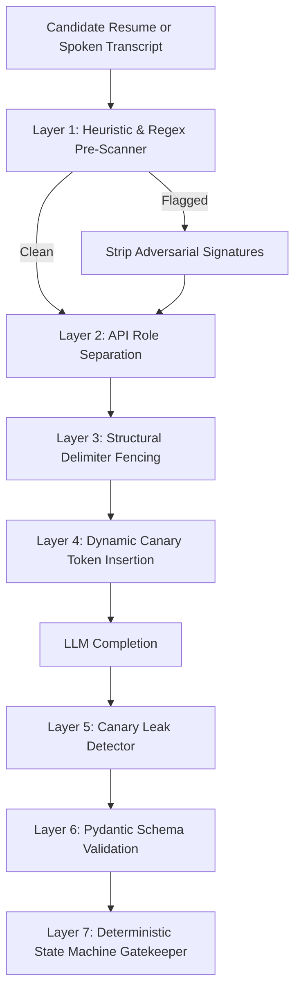

# Security Architecture & Threat Model — CareerDiff

**Document Version:** 1.2.0  
**Status:** Approved Security Specification  

---

## 1. Threat Modeling (STRIDE Analysis)

| STRIDE Category | Threat Description | Attack Vector in CareerDiff | Mitigations Implemented |
| :--- | :--- | :--- | :--- |
| **Spoofing** | Attacker impersonates candidate or hijacks WebSocket session. | Replay of intercepted connection tokens; brute-force session IDs. | Short-lived (60s) single-use WebSocket tickets stored in Redis and consumed via atomic `GETDEL`; cryptographically signed JWTs; WSS enforcement. |
| **Tampering** | Modification of resume text, rubric scores, or transcript turns. | Manipulating API payloads or intercepting database transactions. | Server-side cryptographic hash verification for uploaded files; foreign-key invariants; Pydantic schema validation. |
| **Repudiation** | Candidate or evaluator denies generating answers or scores. | Disputing low scores or claim verifications. | Immutable turn logging in PostgreSQL with monotonic turn indices, client IP hashes, and timestamped audio offsets. |
| **Information Disclosure** | Leakage of candidate PII, transcripts, or system prompts. | Unauthorized access to `/interviews/{id}`; prompt injection leaks. | Row-Level Security (RLS) policies in PostgreSQL; candidate ownership verification middleware; strict canary leak detection. |
| **Denial of Service** | Flooding WebSocket gateway or LLM provider with spam audio. | Infinite PCM streaming; rapid-fire API requests to exhaust LLM budget. | Token-bucket rate limiting (Redis); max 60-minute hard cap on interview sessions; max 50MB audio stream budget per session. |
| **Elevation of Privilege**| Candidate gains access to recruiter/admin rubric configuration. | Manipulating JWT role claims or modifying rubrics directly. | Role-Based Access Control (RBAC) enforced via FastAPI dependency injection (`require_role("ADMIN")`). |

---

## 2. Multi-Layer Prompt Injection Defense (Beyond XML Fencing)

Technical hiring and interview practice platforms are uniquely vulnerable to **Indirect Prompt Injection**: malicious candidates embed adversarial instructions inside resume PDFs or speak adversarial phrases aloud.

### Defense-in-Depth Layers:
1. **Heuristic & Regex Pre-Scanner**:
   Raw resume and transcript text is scanned for common prompt injection signatures (`"ignore previous instructions"`, `"system prompt"`, `"you are now in DAN mode"`, `"developer override"`). Detected phrases are neutralized before LLM context construction.
2. **Strict API Role Separation**:
   Untrusted candidate text is **never** injected into system instruction prompts. It is passed strictly within `user` message role blocks.
3. **Structural XML Delimiter Fencing**:
   Untrusted input is wrapped within strict XML tags:
   `<candidate_untrusted_input> ... </candidate_untrusted_input>`.
4. **Dynamic Canary Token Insertion & Leak Detection**:
   Each session prompt injects an ephemeral, per-turn random canary token (e.g., `canary_7f8a9b2c`). If the LLM completion echoes or leaks the canary, the turn is immediately flagged for audit.
   > [!IMPORTANT]
   > **Detection vs. Prevention Boundary**: Canary tokens serve exclusively as an **automated detection and alerting mechanism** for prompt extraction or instruction echoing; **they do not prevent prompt injection**. They cannot prevent an adversarial candidate from attempting semantic steering or goal manipulation.
5. **Deterministic Application Code Enforcement (Absolute Boundary)**:
   **All permissions, tool access, state transitions, session completions, and database mutations are strictly enforced by deterministic Python application code**. The LLM is never granted authority to execute database writes, invoke external tools, alter session policy, or self-assign rubric scores.
6. **Schema-Constrained Pydantic Output**:
   The completion must parse into a strict Pydantic v2 schema (`InterpretationResult` or `RubricEvaluation`). Free-form conversational attacks fail validation and trigger deterministic fallbacks.
7. **Deterministic State Machine Gatekeeper**:
   Regardless of what the LLM generates, the deterministic engine enforces hard invariants: the LLM cannot skip competencies, terminate sessions early, alter rubrics, or self-assign scores.

---

## 3. Provider Failover Privacy Restrictions

To comply with data protection regulations, **failover targets must strictly adhere to the same privacy tier as the primary provider**:

1. **Zero-Retention Enterprise DPA Requirement**:
   - The primary LLM provider operates under an Enterprise Data Processing Agreement (DPA) / Business Associate Agreement (BAA) with a **contractual guarantee of zero data retention, zero training on customer prompts, and immediate ephemeral cache deletion**.
2. **Prohibition of Non-Compliant Fallback**:
   - The orchestrator is **strictly forbidden** from falling back to public consumer APIs or third-party gateways that retain prompts or use customer data for model training.
3. **Deterministic Emergency Fallback**:
   - If all compliant providers become unreachable (e.g. concurrent outages), the engine must fail over to **pre-compiled, rule-based deterministic questions**, never to a non-compliant provider.

---

## 4. Multi-Tier Retention, Processing & Comprehensive Deletion Policies

CareerDiff strictly separates three distinct data classes with independent retention lifecycles:

```mermaid
flowchart TD
    subgraph Tier 1: Raw Voice Audio
        Audio[Raw PCM Frames] --> RAM[In-Memory Chunks: Discarded upon Turn End]
        RAM -.->|Opt-In Only| S3[S3 Storage: 30-Day Automated Lifecycle TTL]
        S3 --> S3Purge[Permanent Purge: Versions + DeleteMarkers]
    end

    subgraph Tier 2: Text Transcripts
        STT[Confirmed Transcripts] --> DBTurn[PostgreSQL interview_turns]
        DBTurn --> AccountLife1[Retained for Candidate Practice History]
    end

    subgraph Tier 3: Assessment Reports & Evidence
        Eval[Evaluations & Evidence] --> DBReport[PostgreSQL assessment_reports & evidence]
        DBReport --> AccountLife2[Retained until Candidate Erasure Request]
    end
```

### 4.1 Distinct Retention Tiers
1. **Tier 1: Raw Voice Audio (High Sensitivity / Biometric Risk)**:
   - **Default Mode (Ephemeral Streaming)**: Inbound candidate PCM audio chunks are processed in server RAM for VAD and STT transcription, then **discarded from RAM immediately upon turn finalization**. Zero audio bytes are written to disk.
   - **Opt-In Mode (Practice Review Playback)**: If candidate explicitly opts in, combined session audio is stored in an S3 bucket with a strict **30-day automated lifecycle expiration policy**. After 30 days, the object is permanently destroyed.
2. **Tier 2: Text Transcripts (Moderate Sensitivity)**:
   - Text turns and monotonic timestamps are stored in PostgreSQL to enable practice revision, trend tracking, and historical score comparison across practice interviews.
   - Retained for the lifetime of the candidate account.
3. **Tier 3: Assessment Reports & Normalized Evidence (Analytical Data)**:
   - Competency scores, normalized evidence excerpts, and study guides are stored in PostgreSQL.
   - Retained alongside candidate profile until explicitly deleted by the user.

### 4.2 Comprehensive Deletion Protocol (GDPR Article 17 Right to Erasure)
When a candidate invokes `DELETE /api/v1/candidates/me`, the system executes a **comprehensive, multi-system erasure workflow**:

1. **PostgreSQL Relational Hard Deletion**:
   - Atomic cascading delete purges candidate profiles, resumes, extracted claims, interview sessions, turns, scores, reports, and evidence records from the primary database.
2. **Object Storage (S3 / MinIO) Permanent Erasure**:
   - Deletion must not leave soft-deleted markers. The purge workflow calls `DeleteObjects` specifying every object key **including all non-current object versions and delete markers (`DeleteMarkers`)**, preventing version resurrection.
3. **Database Backup Sanitization & Crypto-Shredding**:
   - Daily database snapshot backups enforce a strict 30-day automated expiration cycle.
   - To guarantee immediate unrecoverability in immutable backups prior to snapshot expiration, candidate PII fields are encrypted at rest with candidate-specific encryption keys. Deletion triggers **Cryptographic Erasure (Crypto-Shredding)** by destroying the candidate's key, rendering historical backup rows permanently indecipherable.
4. **Read Replica Synchronization**:
   - Deletion transaction cascades through PostgreSQL write-ahead logs (WAL) to all read replicas, verified via replication lag monitoring ($\text{lag} \le 5$ seconds).
5. **Provider-Held Ephemeral Caches**:
   - Enforced contractually via Enterprise DPAs requiring zero logging and zero caching of prompt and completion payloads on AI provider infrastructure.

---

## 5. Jurisdiction-Specific Privacy & Compliance Analysis

1. **GDPR (EU) & UK GDPR**:
   - **Article 15 (Access)**: Candidates can export their entire transcript and evaluation dossier as JSON.
   - **Article 17 (Erasure)**: Hard delete supported via `DELETE /api/v1/candidates/me`.
   - **Article 22 (Automated Decision-Making)**: CareerDiff MVP is an interview practice simulator, not a hiring decision system. It does not render legal or significant employment effects.
2. **NYC Local Law 144 & EU AI Act (Annex III High-Risk AI)**:
   - **MVP Exemption**: In the MVP (Candidate Practice), CareerDiff is used voluntarily by candidates for personal skill assessment and preparation. It is **not** an Automated Employment Decision Tool (AEDT) under NYC LL 144.
   - **Post-MVP Hiring Requirement (Phase 7+)**: If deployed by enterprise employers for candidate screening, an independent annual bias audit and 10-day candidate notification become mandatory prior to enterprise activation.

---

## 6. Measurable Reliability & Availability Objectives (SLOs)

Rather than stating absolute claims ("100% uptime", "zero data loss"), CareerDiff defines concrete Service Level Objectives:

| Metric | Target Service Level Objective (SLO) | Measurement Method |
| :--- | :--- | :--- |
| **Session Availability** | **99.5%** during active operating hours | Percentage of WebSocket interview sessions without unrecoverable server-side crash. |
| **Recovery Point Objective (RPO)** | **RPO = 0** for finalized speech turns | Every turn is committed to PostgreSQL before downstream action selection. |
| **Recovery Time Objective (RTO)** | **RTO $\le 300$ seconds (5 minutes)** | Dropped WebSocket connections resume at the exact turn index via single-use ticket. |
| **Background Job Delivery** | **99.9% At-Least-Once Delivery** | Guaranteed via Transactional Outbox pattern on PostgreSQL. |
