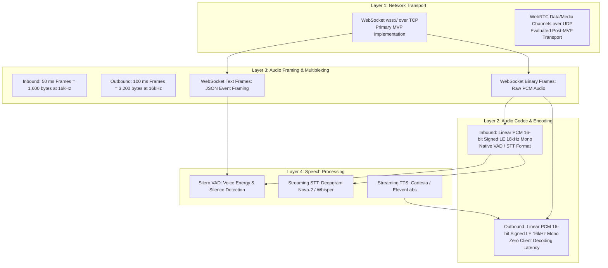

# Voice & Real-Time Streaming Pipeline — IntervueX

**Document Version:** 1.2.0  
**Status:** Approved Technical Architecture  

---

## 1. Architectural Distinction: Transport vs. Codec vs. Framing vs. Speech Processing

To ensure rigorous engineering clarity, the voice architecture strictly separates four distinct layers:



---

## 2. Inbound & Outbound Audio Specifications

| Parameter | Inbound (Candidate $\rightarrow$ Server) | Outbound (Server $\rightarrow$ Candidate) | Architectural Justification |
| :--- | :--- | :--- | :--- |
| **Transport** | WebSocket (`wss://`) | WebSocket (`wss://`) | Multiplexed over a single persistent TCP connection. |
| **Encoding / Codec** | Linear PCM, 16-bit signed, little-endian | Linear PCM, 16-bit signed, little-endian | **Consistent Codec**: Inbound and outbound use identical Linear PCM 16kHz format. Eliminates client-side MP3/Opus decoding latency; browser Web Audio API can directly queue chunks to an `AudioBufferSourceNode`. |
| **Sampling Rate** | 16,000 Hz (16kHz) | 16,000 Hz (16kHz) | Standardized telephony/speech processing sample rate; balances acoustic clarity with bandwidth efficiency. |
| **Channels** | 1 (Mono) | 1 (Mono) | Speech recognition and turn-taking require mono audio only. |
| **Framing Duration**| 50 ms per frame | 100 ms per chunk | 50ms inbound provides responsive VAD; 100ms outbound matches TTS chunk delivery rate. |
| **Frame Size** | 800 samples = 1,600 bytes | 1,600 samples = 3,200 bytes | Predictable binary chunk sizes; direct buffer allocation without reassembly. |

---

## 3. Browser Microphone Resampling (AudioWorklet)

Modern browser `AudioContext` and `navigator.mediaDevices.getUserMedia` typically default to the physical hardware sample rate of the user's audio interface—usually **44,100 Hz (44.1kHz)** or **48,000 Hz (48kHz)**. 

Transmitting 48kHz audio to the server wastes 3x bandwidth and requires CPU-heavy server-side resampling before running 16kHz Silero VAD or Deepgram STT.

### Client-Side Resampling Protocol:
1. The browser UI loads a custom `AudioWorkletProcessor` (`intervuex-capture-processor.js`) running in a dedicated browser audio rendering thread.
2. The worklet receives hardware audio buffers from the microphone at $f_{\text{in}} \in \{44100, 48000\}$.
3. The worklet performs linear interpolation and anti-aliasing low-pass filtering to downsample the stream to exactly $f_{\text{out}} = 16,000$ Hz:
   $$\text{Ratio} = \frac{16000}{f_{\text{in}}}$$
4. The downsampled 16-bit PCM samples are packed into 50 ms chunks (800 samples = 1,600 bytes) and posted to the main thread for immediate WebSocket transmission.

---

## 4. Measurable Engineering Hypotheses (To Be Benchmarked in Phase 5)

Rather than stating latency and threshold figures as accomplished facts, IntervueX treats them as **target performance hypotheses** to be validated during Phase 5 implementation:

```text
Hypothesis 1: End-to-End Turn Latency
  Candidate Silence -> Server VAD -> STT Final -> DB Persist -> Decision/LLM -> TTS First Byte -> Speaker
  Target Budget Hypothesis: p90 <= 1,800 ms

Hypothesis 2: Trailing Silence Threshold
  VAD requires >= 1,200 ms of continuous silence (energy prob < 0.3) to finalize turn.
  Testable Hypothesis: 1,200 ms minimizes candidate turn cutoffs during pauses while avoiding awkward dead air.

Hypothesis 3: Barge-in Cutoff Latency
  Client VAD speech detection -> WebSocket speech_started -> Server TTS stream abort -> Client buffer flush.
  Target Latency Hypothesis: <= 150 ms preemption.
```

---

## 5. Event Framing & Multiplexing Protocol

Binary PCM audio frames and JSON control messages share a single WebSocket connection:

### 5.1 Inbound Candidate Events (JSON text frame)
- `speech_started`: Emitted immediately when browser Web Audio detects voice energy, preempting interviewer TTS playback.
- `speech_stopped`: Emitted when trailing silence is observed on client.
- `text_input`: Dispatched in text fallback mode (`{ "type": "text_input", "text": "..." }`).
- `ping`: Keepalive ping sent every 10 seconds.

### 5.2 Outbound Server Events (JSON text frame)
- `session_ready`: Confirms WebSocket initialization with active turn and state.
- `transcript_partial`: Real-time streaming transcription feedback rendered on screen.
- `transcript_final`: Confirmed speech turn transcript committed to PostgreSQL.
- `interviewer_speaking`: Emitted with question text and action type when TTS stream begins.
- `interviewer_interrupted`: Confirms server abort of TTS upon candidate barge-in.
- `state_change`: Informs UI of macro transitions (`WARMUP` $\rightarrow$ `TECHNICAL_CORE`).

---

## 6. Evaluation of WebRTC as a Future Transport

While WebSockets over TCP provide the simplest architecture for Phase 5, **WebRTC (MediaStream / DataChannel)** is documented as an evaluated post-MVP candidate:
- **When WebRTC Would Be Justified**: If candidate network benchmarking reveals severe TCP head-of-line blocking or jitter under lossy packet conditions ($>5\%$ packet loss).
- **Architectural Trade-Off**: WebRTC uses UDP and SRTP with built-in jitter buffers, but requires deploying dedicated SFU/MCU media servers (e.g., LiveKit, Janus), managing STUN/TURN traversal infrastructure, and decoding RTP packets to PCM before feeding VAD engines.
