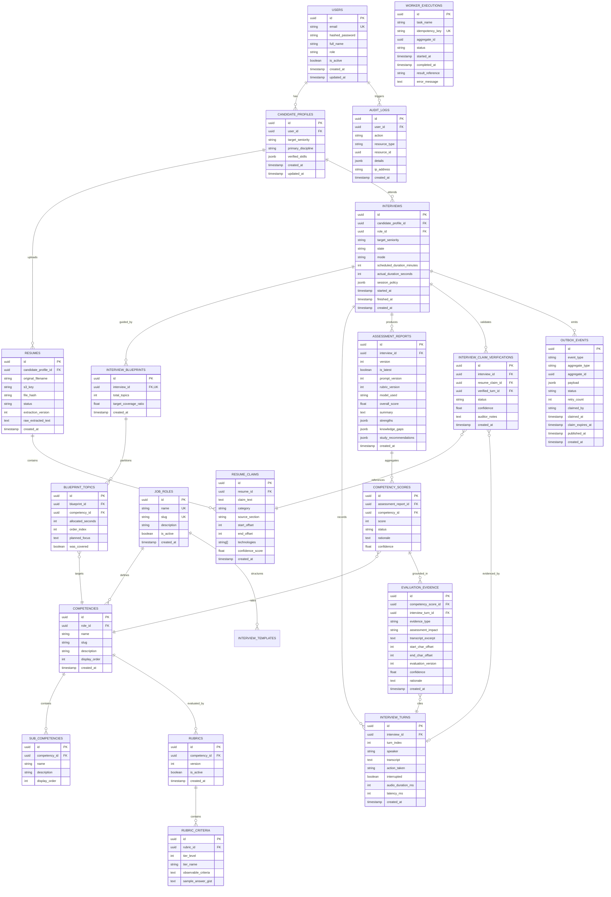

# Entity Relationship Diagram (ERD) — CareerDiff

**Document Version:** 1.2.0  
**Status:** Approved Database Architecture  
**Database Engine:** PostgreSQL 16  

---

## 1. Visual Entity Relationship Diagram

---

## 2. Relational Integrity Architecture

1. **Clarification of Evaluation Modeling**:
   - `TURN_EVALUATIONS` has been removed. Single turns are not graded in isolation.
   - Live turns (`INTERVIEW_TURNS`) record the immediate conversation.
   - Post-interview evaluation produces an immutable, versioned `ASSESSMENT_REPORTS` row (`UNIQUE (interview_id, version)` and `UNIQUE (interview_id) WHERE is_latest = TRUE`).
   - `COMPETENCY_SCORES` represents the aggregate rating per competency for that report version (`UNIQUE (assessment_report_id, competency_id)`).
   - `EVALUATION_EVIDENCE` normalizes verbatim excerpts, character offsets, evidence types, and impacts linking back to specific turns.
2. **Cross-Interview Isolation**:
   - Claim verifications are scoped per session in `INTERVIEW_CLAIM_VERIFICATIONS (interview_id, resume_claim_id)`.
   - Evidence records must belong to turns within the same interview as the report.
3. **Transactional Outbox (`OUTBOX_EVENTS`) & Worker Idempotency (`WORKER_EXECUTIONS`)**:
   - Guaranteed **At-Least-Once Delivery** of background evaluation jobs without dual-write race conditions.
   - Rows are claimed using short-lived row leases (`claim_expires_at`) committing immediately to avoid holding open DB transactions during broker network calls.
   - Consumer idempotency is durably enforced in PostgreSQL via `WORKER_EXECUTIONS (task_name, idempotency_key)`.
   - Concurrent report version creation is safely serialized via exclusive row-level locking on the parent session.
