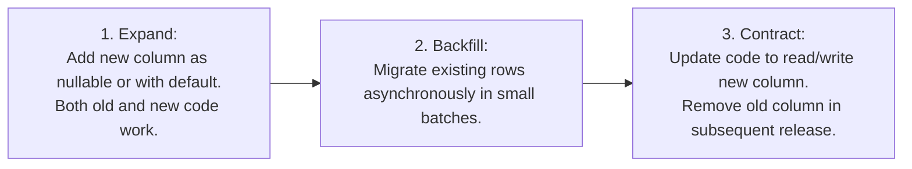

# Database Migration Strategy — CareerDiff

**Document Version:** 1.0.0  
**Status:** Approved Engineering Standard  
**Migration Tool:** Alembic (Async SQLAlchemy 2.0)  

---

## 1. Migration Philosophy: Zero-Downtime Expand/Contract

In a live production environment, database migrations must never lock tables, block concurrent speech turns, or cause breaking API failures. We mandate the **Expand and Contract (Parallel Change) Pattern**:



---

## 2. Core Migration Rules & Prohibitions

1. **No Destructive Drops in Active Releases**:
   - `DROP COLUMN` and `DROP TABLE` are strictly forbidden in any release introducing new application code. Columns are marked deprecated and removed in a subsequent release after verification.
2. **Nullable Columns for Additions**:
   - Every newly added column must either be `NULLABLE` or define a non-blocking `SERVER DEFAULT`. Adding a `NOT NULL` column without a default locks the table on older PostgreSQL versions and breaks concurrent writes.
3. **Concurrent Index Creation**:
   - Production index additions on tables containing $>10,000$ rows must use `CONCURRENTLY` to avoid exclusive write locks:
     ```python
     op.create_index('idx_interview_turns_created', 'interview_turns', ['created_at'], postgresql_concurrently=True)
     ```
4. **Reversible Migrations**:
   - Every Alembic migration file must contain a fully implemented, working `downgrade()` function. Migrations containing `pass` or non-reversible logic in `downgrade()` fail CI review.

---

## 3. Standard Migration Workflow

### Generating a New Migration
```bash
# 1. Update SQLAlchemy models in backend/app/models/
# 2. Generate migration script
uv run alembic revision --autogenerate -m "add_confidence_score_to_claims"

# 3. Inspect generated script in backend/alembic/versions/
# Verify constraints, types, and downgrade path!
```

### Applying Migrations Locally
```bash
# Apply all pending migrations
uv run alembic upgrade head

# Rollback one migration
uv run alembic downgrade -1

# Inspect current revision
uv run alembic current
```

---

## 4. Continuous Integration (CI) Verification

Every Pull Request modifying database models triggers an automated CI verification pipeline:
1. Boots a clean PostgreSQL 16 container.
2. Executes `alembic upgrade head` from scratch (base $\rightarrow$ head).
3. Executes `alembic downgrade base` to verify every rollback works.
4. Executes `alembic upgrade head` again.
5. Runs test seed fixtures to ensure all constraint logic succeeds.
