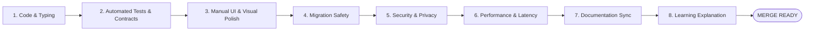

# Definition of Done (DoD) — IntervueX

**Document Version:** 1.2.0  
**Status:** Approved Quality Gate  

---

## 1. Feature & Bugfix Completion Checklist

A task, feature, or bugfix in IntervueX is **NOT** done until all 8 verification gates are passed:

---

## 2. Gate Verification Requirements

### Gate 1: Code Quality & Typing
- [ ] Code strictly follows [CODING_STANDARDS.md](CODING_STANDARDS.md).
- [ ] `ruff check backend/` passes with zero errors or warnings.
- [ ] `mypy backend/app/` passes in strict mode (`--strict`) with zero errors.
- [ ] `npm run typecheck` passes with zero TypeScript compiler diagnostics.
- [ ] `npm run lint` passes with zero ESLint errors or warnings.
- [ ] No `any` types present in TypeScript code.

### Gate 2: Automated Tests & QA Verification (Full-Stack Verification)
- [ ] Relevant unit and integration tests written and committed under `backend/tests/` and `frontend/`.
- [ ] `uv run pytest backend/tests/` runs locally and passes with 100% success rate.
- [ ] `npm test` runs locally and passes for frontend components and stores.
- [ ] Cross-layer schema parity verified (Pydantic models mirror TypeScript interfaces).
- [ ] Full-stack QA Verification Matrix generated and attached to handover (Rule 19 & `qa-verify-feature`).
- [ ] Critical invariants have 100% path coverage:
  - State machine transitions & legal action validation.
  - Policy guardrails and time/probe boundary overrides.
  - Evidence integrity and transcript offset verification.
  - Database transactional durability (atomic turn commit).
- [ ] Overall test suite maintains a healthy baseline ($\ge 80\%$) as an operational indicator.
- [ ] Negative test cases and edge cases (e.g. invalid input, timeouts, 422 RFC 7807 responses) are tested.

### Gate 3: Meticulous Manual UI & Visual Polish (Zero Minor UI Defect Policy)
- [ ] Viewport responsiveness verified at 375px (Mobile), 768px (Tablet), 1280px (Desktop), and 1920px.
- [ ] Zero unintended horizontal overflow (`document.documentElement.scrollWidth === window.innerWidth`).
- [ ] All interactive elements verify the 6-state rule (Default, Hover, Focus-Visible, Active, Disabled, Loading).
- [ ] Spacing follows the 4px/8px Tailwind scale; icons vertically centered (`inline-flex items-center gap-2`).
- [ ] Layout stability (Zero CLS): Skeletons or reserved aspect ratios prevent layout jumping.
- [ ] Empty states and extreme text lengths (100+ chars) render gracefully without breaking borders.
- [ ] Full keyboard walkthrough verified (`Tab`, `Shift+Tab`, `Enter`, `Space`, `Escape`); modal traps focus.

### Gate 4: Database & Migration Safety (If DB modified)
- [ ] Alembic migration contains a fully working `upgrade()` and `downgrade()`.
- [ ] New columns are nullable or have server defaults (no table locks).
- [ ] Tested migration upgrade and rollback from scratch against clean database.

### Gate 5: Security & Privacy
- [ ] No PII or raw secrets logged in application output.
- [ ] Prompt injection boundaries verified for any new LLM prompts (`<candidate_untrusted_input>`).
- [ ] Endpoints enforce authentication and authorization scopes.
- [ ] Zero biometric or emotion analysis models introduced.

### Gate 6: Performance & Latency
- [ ] Database queries are indexed; no N+1 query loops.
- [ ] Redis session keys have explicit TTLs.
- [ ] WebSocket handlers do not block the asyncio event loop.

### Gate 7: Documentation Sync
- [ ] Relevant documents in `docs/` updated to reflect schema, API, or state changes.
- [ ] Architectural decisions documented in ADRs if architectural change was made.

### Gate 8: Learning-First Explanation
- [ ] The 15-point learning breakdown explained to the developer.
- [ ] Developer confirmed understanding and knows how to debug or reproduce the change independently.
