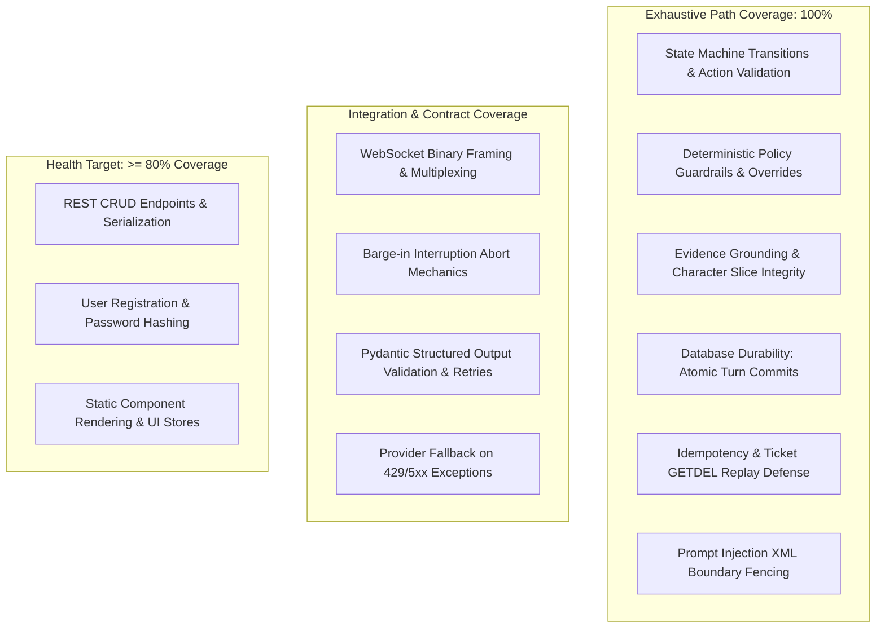
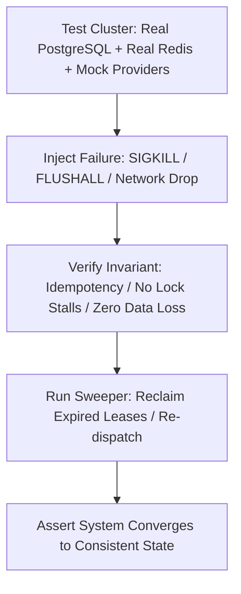

# Testing Strategy & Quality Assurance — IntervueX

**Document Version:** 1.1.0  
**Status:** Approved Engineering Standard  

---

## 1. Quality Philosophy: Risk-Based Testing over Vanity Metrics

Blanket line coverage metrics (e.g. "always 85% across everything") create a false sense of security: developers write trivial tests for boilerplate getters while leaving concurrency, state transitions, and database rollbacks untested.

IntervueX adopts **Risk-Based Testing**: testing depth is directly proportional to failure impact.



---

## 2. Priority Risk Areas & Verification Requirements

| Priority Rank | Functional Area | Failure Mode Risk | Required Testing Verification |
| :--- | :--- | :--- | :--- |
| **P1** | **Interview State Transitions** | Illegal state bypass (e.g. jumping from WARMUP to COMPLETED). | Exhaustive matrix test verifying every legal and illegal transition in `InterviewStateMachine`. |
| **P1** | **Decision Policy Guardrails** | Infinite probing loop; exceeding max time; ignoring required topics. | Unit tests asserting deterministic overrides when probe limit or time budgets are reached. |
| **P1** | **Evidence Integrity** | Score generated without verbatim transcript grounding. | Semantic validation test asserting `evaluation_evidence` excerpt strictly matches transcript slice. |
| **P1** | **Database Durability** | Speech turn lost due to uncommitted transaction before TTS crash. | Transaction rollback test: assert turn exists in DB before downstream coroutines are scheduled. |
| **P1** | **Security & Injection** | Malicious resume text commandeering interview prompts. | Adversarial penetration test suite verifying `<candidate_untrusted_input>` fencing. |
| **P2** | **Session Recovery & Idempotency** | Replayed tickets or orphaned sessions on reconnect. | Concurrency test asserting atomic `GETDEL` rejects replayed WebSocket tickets. |
| **P2** | **WebSocket Audio Framing** | Frame corruption, buffer underflow, or connection drop. | Async WebSocket test streaming binary PCM frames and asserting state events. |
| **P2** | **Structured Output Schema** | LLM outputs invalid JSON or non-existent enum value. | Contract test asserting Pydantic v2 validation error triggers automatic retry. |

---

## 3. Mocking Policy: Real Dependencies vs. Deterministic Fixtures

1. **What We Do NOT Mock**:
   - **PostgreSQL 16**: Integration tests run against a real, isolated PostgreSQL test database with transaction rollbacks per test. We test real foreign keys, check constraints, and migrations.
   - **Redis 7**: Integration tests run against a real local Redis instance to verify ticket expiration and ARQ queuing.
2. **What We DO Mock**:
   - **External Paid AI APIs (LLM, STT, TTS)**: We do not incur cost or introduce network flakiness in automated CI runs. We mock external APIs using deterministic, recorded JSON/audio fixtures that strictly validate input parameters and return realistic responses.

---

## 4. Frontend (UI) Testing Strategy

Testing the React + TypeScript frontend encompasses three complementary layers:

1. **Static Analysis & Type Integrity**:
   - `npm --prefix frontend run typecheck`: Validates full strict TypeScript AST compliance; detects broken prop contracts.
   - `npm --prefix frontend run lint`: Enforces ESLint and React hooks dependency completeness (`react-hooks/exhaustive-deps`).
2. **Component & User Interaction Tests (Vitest + React Testing Library)**:
   - Render UI components in isolation with mocked server queries (MSW - Mock Service Worker).
   - Verify accessibility selectors (`getByRole`, `getByLabelText`), loading spinners, empty states, and disabled submit states.
   - Assert TanStack Query mutations trigger cache invalidations and update DOM state without full page refreshes.
3. **Web Audio API & Stream Lifecycle Tests**:
   - Assert `AudioContext` and media stream tracks are closed on component unmount (`useEffect` cleanup).
   - Verify transient UI volume meters in Zustand update accurately without triggering excessive re-renders.

---

## 5. Meticulous Manual & Visual UI Verification (Zero Minor UI Defect Policy)

Automated tests verify that logic executes; **meticulous manual inspection verifies that humans have a frictionless, polished, and immersion-grade experience**.

### The 6 Manual Verification Pillars
1. **Responsive Viewport Matrix**:
   - Manually inspect at 375px (Mobile), 768px (Tablet), 1280px (Desktop), and 1920px (Ultra-wide).
   - Verify zero horizontal scrolling leaks (`document.documentElement.scrollWidth === window.innerWidth`).
2. **Interactive States Completeness (The 6-State Rule)**:
   - Every button, input, toggle, and tab must be verified across: Default, Hover, Focus-Visible, Active/Pressed, Disabled, and Loading.
3. **Visual Alignment & Spacing Cadence**:
   - Enforce standard 4px/8px Tailwind scale. No arbitrary pixel offsets (`mt-[7px]`).
   - Vertically align icons and text via `inline-flex items-center gap-2`.
4. **Layout Stability (Zero Cumulative Layout Shift - CLS)**:
   - Reserve space for dynamic charts, waveforms, and candidate avatars with skeletons to eliminate jarring page jumps.
5. **Content Edge Cases**:
   - Test empty states with friendly guidance and primary CTA.
   - Test extreme string lengths (100+ characters) to ensure graceful wrapping or ellipsis truncation.
6. **Keyboard Navigation & Focus Trap**:
   - Full walkthrough using only `Tab`, `Shift+Tab`, `Enter`, `Space`, and `Escape`.
   - Modals must trap focus and restore focus to trigger element upon closing.

---

## 7. Distributed Systems Failure Injection & Chaos Testing

Distributed systems inevitably fail under network partitions, broker crashes, worker terminations, and lease timeouts. To guarantee that IntervueX upholds its durability and at-least-once invariants, the test suite includes automated **Chaos & Fault Injection Tests** located in `backend/tests/integration/test_fault_injection.py`:



### The 6 Mandatory Failure Injection Suites
1. **Duplicate Event Delivery (`test_duplicate_event_delivery`)**:
   - Deliver the exact same `outbox_events` payload twice to the Taskiq worker.
   - Assert: `worker_executions` unique constraint stops the second run; exactly 1 `assessment_reports` record exists; 0 redundant LLM calls made.
2. **Worker Process Termination Mid-LLM (`test_worker_sigkill_recovery`)**:
   - Send `SIGKILL` to the Taskiq worker process while `AssessmentEvaluator` is waiting on LLM completion.
   - Assert: Incomplete database transaction rolls back cleanly; no partial or orphaned scores; the Reconciliation Sweeper detects uncompleted evaluation and re-enqueues after lease expiry.
3. **Ephemeral Broker Data Loss (`test_redis_flush_recovery`)**:
   - Enqueue 10 evaluation jobs, then execute `redis.flushall()` before workers can consume them.
   - Assert: PostgreSQL `outbox_events` remains unaffected; OutboxPoller lease expiration triggers reclamation; all 10 jobs are successfully re-enqueued and completed.
4. **Concurrent Report Generation Race (`test_concurrent_report_serialization`)**:
   - Spawn two concurrent worker tasks for the same `session_id`.
   - Assert: PostgreSQL row-level lock on `interviews` serializes insertion; version 1 and version 2 are created sequentially without `uq_interview_report_version` violation; exactly 1 report has `is_latest = TRUE`.
5. **Outbox Poller Crash with Expired Claims (`test_outbox_expired_claim_reclamation`)**:
   - OutboxPoller claims 5 rows (`status = 'CLAIMED'`) and immediately raises an unhandled exception before calling the broker.
   - Fast-forward time past `claim_expires_at` (30 seconds).
   - Assert: Next poller cycle or sweeper successfully reclaims the expired rows and publishes them to the broker.
6. **Broker Network Partition During Outbox Polling (`test_broker_partition_nonblocking_tx`)**:
   - Sever network access to Redis during `OutboxPoller.publish_batch()`.
   - Assert: OutboxPoller catches the broker network timeout; database transactions and row locks are **not held open**; PostgreSQL connections are returned cleanly to the pool; claimed rows remain safe for reclamation.

---

## 8. Full-Stack Verification Commands & Protocol

Follow the [QA Verification Skill (`qa-verify-feature`)](../../.agents/skills/qa-verify-feature/SKILL.md) and [Rule 19](../../.agents/rules/19-qa-verification.md) to execute the verification suite:

```bash
# === Backend Verification ===
# Run unit and integration tests
uv run pytest backend/tests/ -v

# Run risk-based critical invariant suite
uv run pytest backend/tests/unit/test_state_machine.py backend/tests/unit/test_guardrails.py backend/tests/unit/test_evidence_integrity.py -v

# Run code style, types, and security audit
uv run ruff check backend/
uv run mypy backend/app/ --strict
uv pip audit

# === Frontend Verification ===
# Run TypeScript compilation check
npm --prefix frontend run typecheck

# Run frontend unit & component tests
npm --prefix frontend test

# Run frontend linting
npm --prefix frontend run lint
```

### Invariant:
Never merge code or mark a task complete without executing the relevant automated test suite locally and confirming a 100% pass rate. Every completion handover must present the compiled **QA Verification Matrix**.
