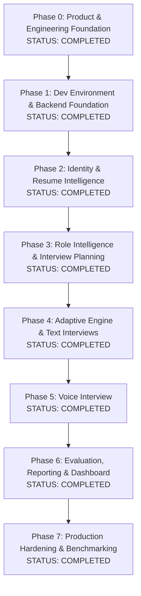

# Canonical Phased Engineering Roadmap — CareerDiff

**Document Version:** 1.1.0  
**Status:** Approved Canonical Roadmap  

---

## 🗺️ Canonical 8-Phase Progression

### Strategic Philosophy: Text-First, Voice-Next
We deliberately decouple the **cognitive intelligence** of the interview engine from the **low-level network complexity of real-time audio streaming**. In Phase 4, we build and verify the complete Adaptive Decision Engine, turn-taking state machine, and rubric evaluator in **Text Mode**. Once the deterministic engine is bulletproof and thoroughly tested, Phase 5 layers the real-time Web Audio, VAD, STT, and TTS streaming pipeline on top.

---

## Phase 0: Product & Engineering Foundation
- **Status**: **COMPLETED** (Verified)
- **Objectives**: Establish complete authoritative documentation, Antigravity rules system, engineering constitution, architecture decision records, data models, and developer runbooks without premature application code.
- **Dependencies**: None.
- **Deliverables**:
  - Full Product & PRD documentation (`docs/product/`).
  - System architecture, component designs, and 10 ADRs (`docs/architecture/`).
  - Database ERD and normalized data model specifications (`docs/database/`).
  - REST and WebSocket protocol specifications (`docs/api/`).
  - Engineering standards, testing strategy, and debugging guide (`docs/engineering/`).
  - Pedagogical learning curriculum, glossary, and journal (`docs/learning/`).
  - Root `AGENTS.md`, 18 Antigravity rules (`.agents/rules/`), and 10 reusable skills (`.agents/skills/`).
- **Learning Objectives**:
  - Modular Monolith architecture boundaries and trade-offs.
  - Hybrid AI control (Deterministic State Machines vs Probabilistic LLMs).
  - Antigravity agent configuration and progressive disclosure rules.
- **Tests**: Static file existence verification, Markdown link integrity checks, YAML frontmatter syntax validation.
- **Acceptance Criteria**: All 65+ architectural, database, API, and product documents created, cross-referenced, and verified without contradictions.
- **Exit Criteria**: Foundation blueprint review completed, approved, and logged in `docs/engineering/FOUNDATION_REVIEW.md`.

---

## Phase 1: Development Environment & Backend Foundation
- **Status**: **COMPLETED** (Verified)
- **Objectives**: Set up the local developer container environment (PostgreSQL 16, Redis 7, MinIO), initialize the Python 3.12+ FastAPI backend skeleton using `uv`, configure async SQLAlchemy 2.0 and Alembic, establish health check endpoints, and set up the automated testing harness.
- **Dependencies**: Phase 0 (Complete).
- **Deliverables**:
  - `docker-compose.yml` with PostgreSQL 16, Redis 7, and MinIO.
  - `backend/pyproject.toml` managed via `uv` with strict dependencies and dev tooling.
  - `backend/app/main.py` with FastAPI initialization, CORS, and lifespan management.
  - `backend/app/core/database.py` with async connection pool and session factories.
  - `backend/alembic.ini` and initial baseline migration structure.
  - Health check endpoints: `GET /api/v1/health`, `GET /api/v1/health/db`, `GET /api/v1/health/redis`.
- **Learning Objectives**:
  - Modern deterministic Python packaging with `uv`.
  - Asynchronous event loops and connection pooling in SQLAlchemy 2.0 with `asyncpg`.
  - Health check probe patterns for container orchestration.
  - Pytest async fixture configuration with clean database rollbacks.
- **Tests**:
  - Unit tests for configuration loading and validation.
  - Integration tests for database and Redis health check endpoints.
  - Migration smoke tests (apply and rollback).
- **Acceptance Criteria**:
  - `docker compose up -d` boots healthy PostgreSQL, Redis, and MinIO containers.
  - `uv run pytest` executes and passes against test database.
  - `GET /api/v1/health` returns `200 OK` with database and cache connectivity confirmed.
- **Exit Criteria**: Developer can start local backing services, run migrations, and execute passing tests with a single command.

---

## Phase 2: Identity & Resume Intelligence
- **Status**: **COMPLETED** (Verified)
- **Objectives**: Implement user registration/authentication, secure file ingestion for resumes (PDF/DOCX), layout-aware text extraction, structured Pydantic parsing, and claim extraction with source character offset provenance.
- **Dependencies**: Phase 1 Backend Foundation.
- **Deliverables**:
  - Authentication endpoints: `POST /api/v1/auth/register`, `POST /api/v1/auth/login`.
  - Resume upload and processing: `POST /api/v1/resumes`, `GET /api/v1/resumes/{id}`.
  - Database tables: `users`, `candidate_profiles`, `resumes`, `resume_claims`.
  - Pydantic extraction schemas and prompt delimiter fencing against indirect injection.
  - PyMuPDF text block extraction with character offset tracking.
- **Learning Objectives**:
  - Secure password hashing (Argon2 / Bcrypt) and JWT access/refresh token rotation.
  - S3-compatible blob storage handling with `aiobotocore`.
  - Binary PDF layout extraction and character offset math for claim provenance.
  - Prompt injection defense using structural XML fencing.
- **Tests**:
  - Unit tests for token signing, claim schema validation, and PDF parsing.
  - Integration tests for user registration, login, and resume upload.
  - Provenance tests verifying that extracted claims match exact slices in raw resume text.
- **Acceptance Criteria**:
  - Candidates can register and obtain a valid JWT.
  - Uploaded PDF resumes produce structured profile records and testable claims with exact character offsets.
- **Exit Criteria**: Extracted claims accurately link to character offsets on sample test resumes.

---

## Phase 3: Role Intelligence & Interview Planning
- **Status**: **COMPLETED** (Verified)
- **Objectives**: Create configurable role and competency libraries, versioned 4-tier rubrics, and the deterministic `InterviewBlueprint` builder that allocates topic time budgets and maps candidate resume claims to target competencies.
- **Dependencies**: Phase 2 Candidate Profiles & Claims.
- **Deliverables**:
  - Seeded catalog for Backend, Frontend, and Fullstack roles with 4-tier rubrics.
  - Database tables: `job_roles`, `competencies`, `sub_competencies`, `rubrics`, `rubric_criteria`, `interviews`, `interview_blueprints`, `blueprint_topics`.
  - Blueprint builder service partitioning session time into topic budgets.
  - REST endpoints: `GET /api/v1/roles`, `POST /api/v1/interviews`.
- **Learning Objectives**:
  - Relational modeling of competency trees and immutable rubric versioning.
  - Time-partitioning algorithms and mathematical budget invariants.
  - Bipartite matching between candidate claims and role competencies.
- **Tests**:
  - Unit tests verifying blueprint topic budgets sum to scheduled interview duration.
  - Tests ensuring required competencies are prioritized in blueprints.
- **Acceptance Criteria**:
  - Calling `POST /api/v1/interviews` persists an `Interview` and `InterviewBlueprint` with validated time budgets.
- **Exit Criteria**: Blueprint generator consistently produces valid topic allocations for 30, 45, and 60-minute sessions.

---

## Phase 4: Adaptive Interview Engine & Text Interviews
- **Status**: **COMPLETED** (Verified)
- **Objectives**: Build the core intelligence of CareerDiff: the deterministic turn-taking state machine, the 9-action adaptive decision engine, bounded context management, and interactive text-based technical interviews.
- **Dependencies**: Phase 3 Blueprints, Redis 7.
- **Deliverables**:
  - `InterviewStateMachine` enforcing macro state transitions (`WARMUP` $\rightarrow$ `TECHNICAL_CORE` $\rightarrow$ `CONCLUDING`).
  - `AdaptiveDecisionEngine` implementing the 9-action closed decision space and policy guardrails.
  - Turn persistence service guaranteeing ACID turn commits before action generation.
  - Interactive Text Chat web UI allowing full text-based technical interviews.
- **Learning Objectives**:
  - Finite State Machine design in Python with strict invariant enforcement.
  - Sliding-window prompt construction and progressive semantic summarization.
  - Idempotent turn processing and anti-looping guardrails.
- **Tests**:
  - State machine transition tests (legal vs illegal transitions).
  - Guardrail tests asserting policy overrides (e.g. topic change forced after max probes).
  - Durability tests asserting turn commit prior to next-action execution.
- **Acceptance Criteria**:
  - Candidate can complete an adaptive text interview adhering to session policy.
  - Engine probes depth, challenges trade-offs, and verifies resume claims without looping.
- **Exit Criteria**: Text interviews cleanly advance through competencies and conclude within configured time bounds.

---

## Phase 5: Voice Interview
- **Status**: **COMPLETED** (Verified)
- **Objectives**: Layer real-time bidirectional audio streaming onto the proven adaptive engine, implementing Web Audio capture, server VAD, streaming STT, streaming TTS, and instant barge-in interruption.
- **Dependencies**: Phase 4 Adaptive Engine, STT Provider, TTS Provider, Web Audio API.
- **Deliverables**:
  - WebSocket gateway (`/ws/v1/interviews/{id}`) with single-use ticket authentication.
  - Browser Web Audio worklet capturing 16kHz 16-bit Mono Linear PCM frames.
  - Server-side Silero VAD detecting speech energy and turn-ending silence.
  - Streaming STT integration (Deepgram / Whisper) emitting partial and final transcripts.
  - Streaming TTS integration (Cartesia / ElevenLabs).
  - Barge-in interruption handler aborting TTS on candidate speech.
  - Text fallback toggle on audio/network degradation.
- **Learning Objectives**:
  - Web Audio API worklet processors in TypeScript.
  - Binary audio streaming and multiplexing with JSON text control frames.
  - Voice Activity Detection tuning and silence threshold calibration.
  - Asynchronous task preemption and playback queue flushing.
- **Tests**:
  - WebSocket handshake and ticket authentication tests.
  - VAD silence detection tests on simulated PCM waveforms.
  - Barge-in tests asserting TTS cancellation upon `speech_started`.
  - Fallback tests verifying seamless transition from voice to text.
- **Acceptance Criteria**:
  - Candidate speaks, sees real-time partial transcripts, hears synthesized speech responses, and can interrupt naturally.
- **Exit Criteria**: End-to-end voice loop validated with conversational turnaround meeting latency hypotheses.

---

## Phase 6: Evaluation, Reporting & Dashboard
- **Status**: **COMPLETED** (Verified)
- **Objectives**: Build the asynchronous rubric evaluation worker, normalized evidence grounder, resume claim verification ledger, and interactive candidate assessment dossier.
- **Dependencies**: Phase 4 & 5 turn data, ARQ worker, Redis 7.
- **Deliverables**:
  - ARQ background evaluation worker executing decoupled from live turns.
  - Rubric grounder populating normalized `evaluation_evidence` with transcript character offsets.
  - Database tables: `assessment_reports`, `competency_scores`, `evaluation_evidence`, `claim_verifications`.
  - Interactive React assessment dossier with radar charts, evidence citations, and audio playback snippets.
- **Learning Objectives**:
  - Asynchronous task worker architecture with ARQ.
  - Normalized evidence modeling and transcript slicing validation.
  - Interactive SVG data visualizations in React.
- **Tests**:
  - Grounding tests asserting that scores without verbatim transcript excerpts fail validation.
  - Tests ensuring unassessed competencies receive `INSUFFICIENT_EVIDENCE` status.
  - Claim verification auditing tests.
- **Acceptance Criteria**:
  - Completed interviews generate full assessment dossiers within 60 seconds.
  - Every score links directly to clickable transcript evidence in the UI.
- **Exit Criteria**: Assessment dossiers clearly present strengths, gaps, claim verification, and curated study guides.

---

## Phase 7: Production Hardening & Benchmarking
- **Status**: **COMPLETED** (Verified)
- **Objectives**: Production hardening, automated security audits, distributed tracing, rate limiting, and building the 100-scenario synthetic replay benchmark harness.
- **Dependencies**: Phase 6 Complete Stack.
- **Deliverables**:
  - Redis token-bucket rate limiting middleware.
  - OpenTelemetry distributed tracing and structured JSON logging.
  - Automated 100-scenario synthetic candidate replay harness.
  - Model quality and intelligence benchmarking scorecard.
  - Production deployment manifests (Docker Compose / Kubernetes).
- **Learning Objectives**:
  - Distributed tracing context propagation across async tasks and WebSockets.
  - Rate limiting algorithms and DDoS defense.
  - Synthetic data generation for LLM regression testing.
- **Tests**:
  - 100 scenario regression suite.
  - Load testing (50 concurrent voice interviews).
  - Adversarial prompt injection fuzzing suite.
- **Acceptance Criteria**:
  - System sustains 50 concurrent voice sessions without frame drops.
  - Benchmark harness scores the engine across 100 diverse scenarios.
- **Exit Criteria**: Release-ready platform with zero critical vulnerabilities and verified benchmark metrics.
