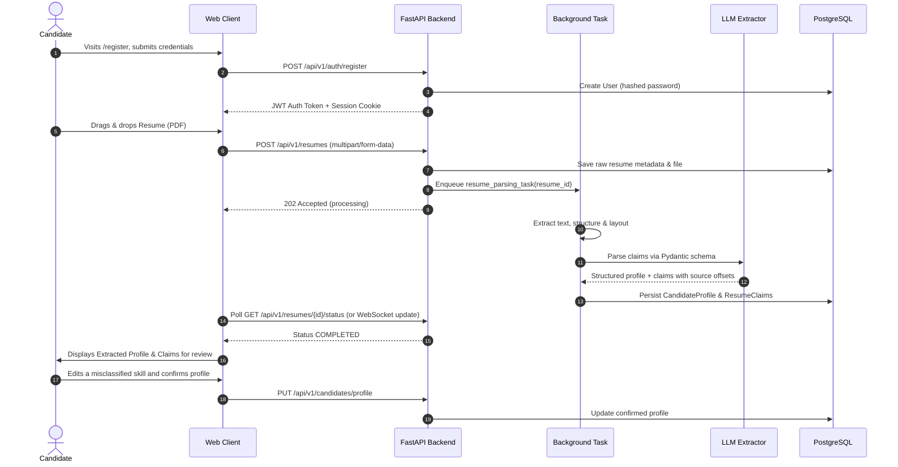
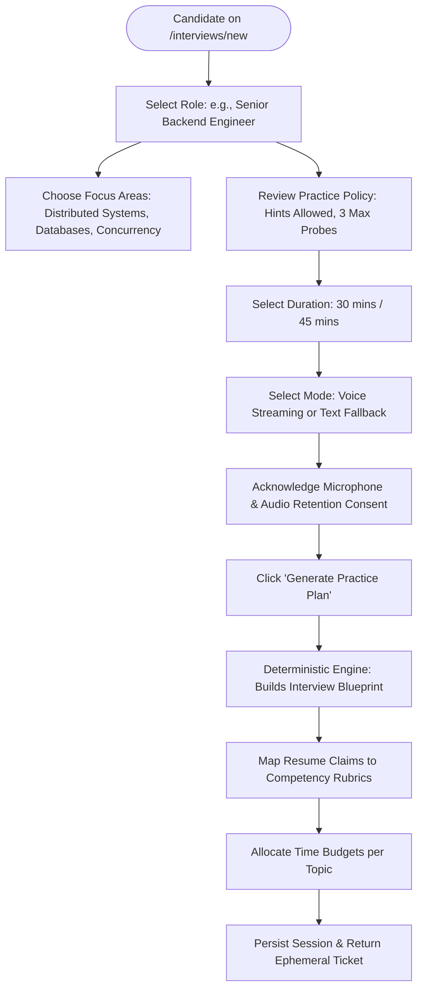
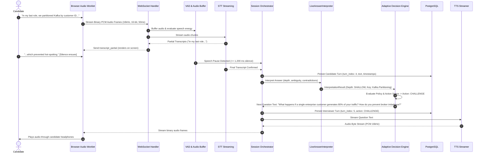
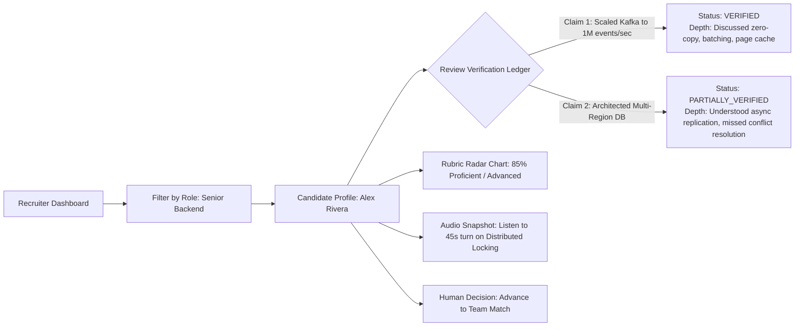

# User Journeys — CareerDiff

This document traces the comprehensive end-to-end user journeys through the CareerDiff platform. Journeys 1 through 4 represent the **Primary MVP Candidate Practice Experience**, while Journey 5 represents the **Preserved Post-MVP Enterprise Assessment Flow**.

---

## Journey 1: Candidate Sign-Up, Resume Upload & Claim Verification (MVP)

### Objective

A candidate registers, uploads their resume, verifies extracted claims, and prepares for an interview.



---

## Journey 2: Configuring the Technical Practice Session (MVP)

### Objective

The candidate configures the target job role, seniority level, and duration, triggering the creation of an interview blueprint with a customizable `InterviewPolicy`.



---

## Journey 3: The Live Adaptive Practice Interview (MVP)

### Objective

Conduct an interactive, real-time voice practice session where `LiveAnswerInterpreter` evaluates depth and triggers follow-up actions with $\le 600$ ms turnaround, decoupled from final reporting.



---

## Journey 4: Post-Interview Feedback & Evidence-Backed Gap Analysis (MVP)

### Objective

The candidate reviews their personal performance dossier, viewing normalized evidence rows, clickable transcript excerpts, and curated reading recommendations.

```mermaid
flowchart TD
    Complete([Interview Concludes]) --> Enqueue[Orchestrator Commits Outbox Event]
    Enqueue --> WorkerRun[Taskiq Worker Runs AssessmentEvaluator]
    WorkerRun --> ScoreCalc[Evaluate Competencies & Ground in Normalized Evidence]
    ScoreCalc --> PersistReport[Persist AssessmentReport & EvaluationEvidence]
    PersistReport --> NotifyUser[Client Displays: 'Report Ready']
    NotifyUser --> ViewDashboard[Candidate Opens /interviews/{id}/report]
  
    subgraph Report Sections
        Summary[Overall Technical Readiness Score & Summary]
        Strengths[Key Demonstrated Strengths with Excerpts]
        Gaps[Identified Knowledge Gaps with Character Offsets]
        ClaimLedger[Resume Claim Verification Ledger]
        TranscriptView[Interactive Transcript with Audio Playback Snippets]
        LearningPath[Curated Reading & Concepts to Review]
    end
  
    ViewDashboard --> Summary
    Summary --> Strengths
    Summary --> Gaps
    Summary --> ClaimLedger
    Summary --> TranscriptView
    Summary --> LearningPath
```

---

## Journey 5: Recruiter Reviewing Candidate Dossier (Preserved Post-MVP Path)

### Objective

A hiring manager reviews a candidate's completed technical dossier to determine whether to invite them for final-round team matching.


